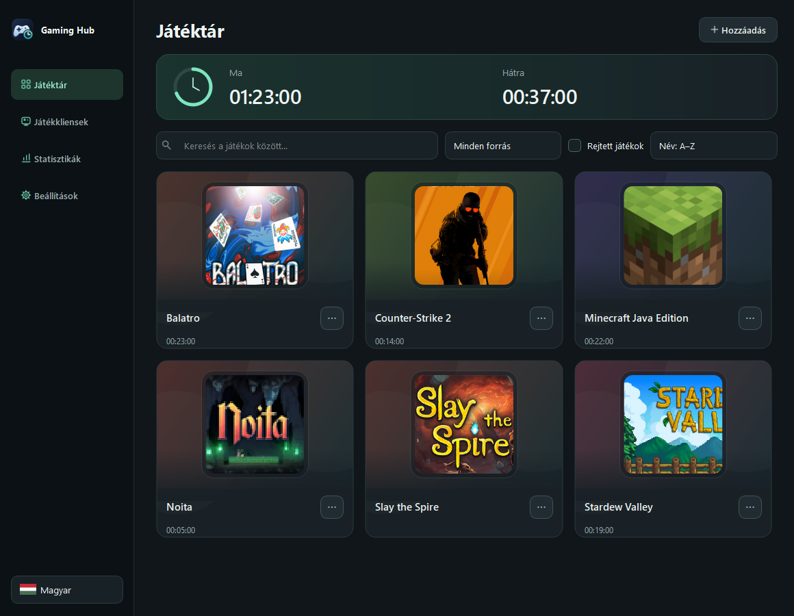
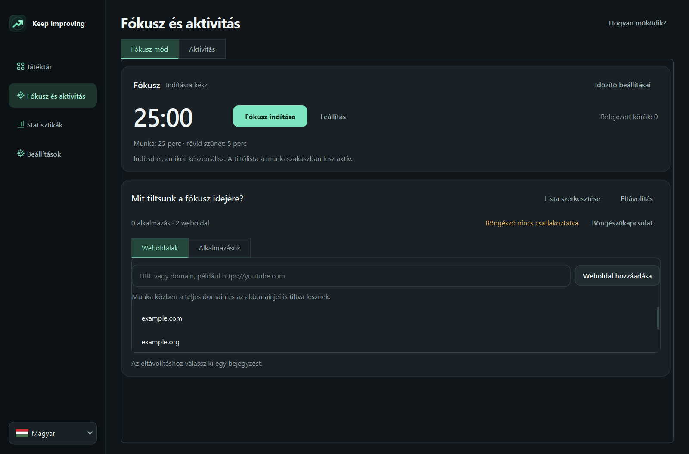
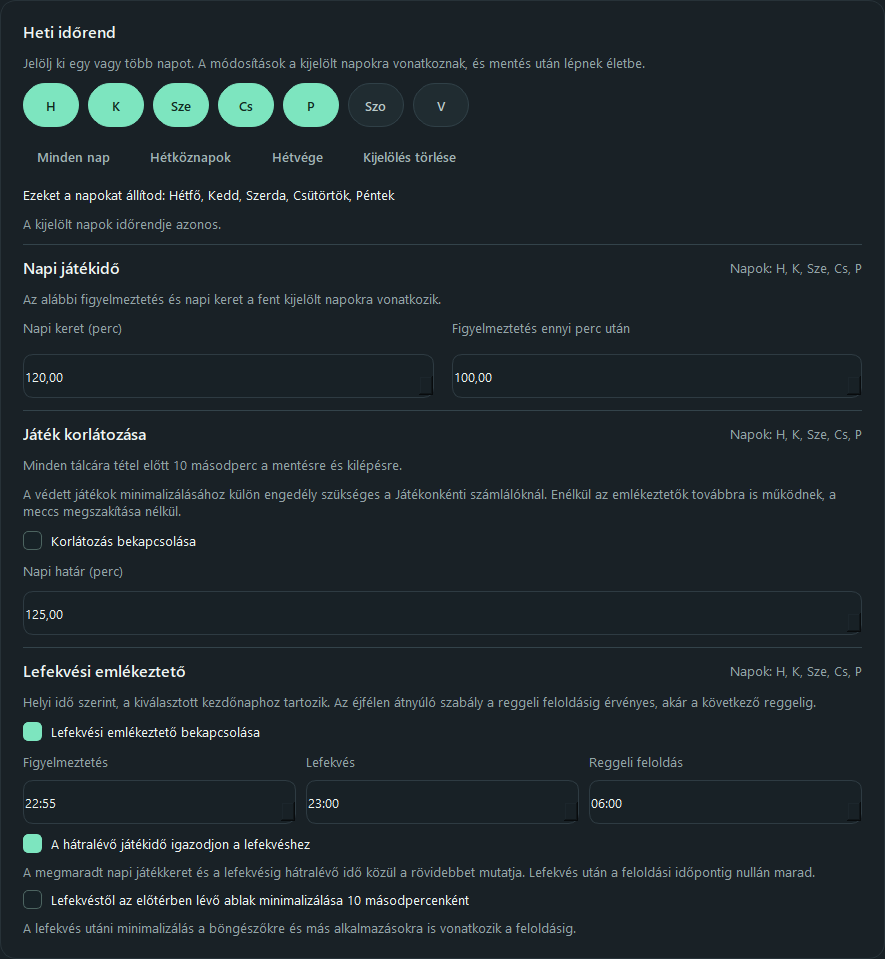
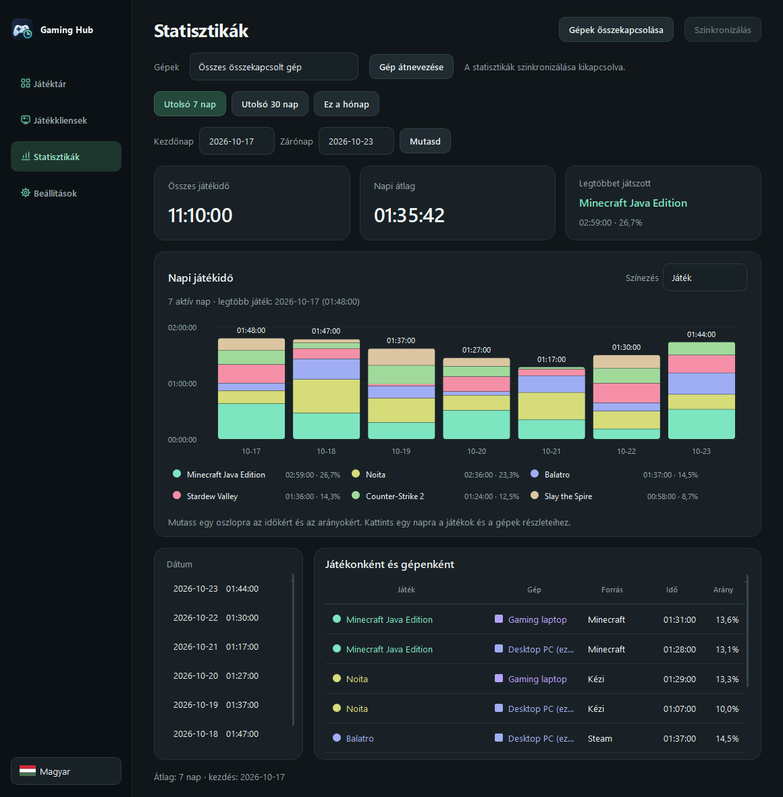

# Keep Improving — 2.31.2

**[Letöltés Windows x64-re — 2.31.2](https://github.com/Blintboi/windows-game-time-monitor/raw/refs/heads/main/downloads/GameTimeMonitor-Setup.exe)** · [SHA-256 ellenőrzőösszeg](downloads/GameTimeMonitor-Setup.exe.sha256) · [English](README.md)

A Keep Improving Windows-alkalmazás megmutatja, mire fordítod a számítógépes idődet, és segít eldönteni, mikor szeretnél összpontosítani vagy játszani. Méri a felismert, előtérben futó játékok idejét, megmutatja a napi játékkeretből hátralévő időt, és a határ elérésekor emlékeztethet vagy kis méretre válthatja a játékot. Ettől külön méri az aktívan használt alkalmazásokat, a böngészőbővítménnyel pedig a weboldalakon töltött időt is. A Pomodoro-időzítő munkaszakaszában ideiglenesen letilthatod a kiválasztott oldalakat, és kis méretre válthatod a megadott alkalmazásokat.

A program ingyenes, nyílt forráskódú, magyar és angol felülettel. A helyi méréshez és a fókuszidőzítőhöz nem kell fiók vagy internet; a weboldalak méréséhez és tiltásához a mellékelt bővítmény szükséges. A saját gépek statisztikáinak és támogatott beállításainak összekapcsolása választható.

*Korábbi, 2.27.0-s játéktár példaelőzményekkel; a navigáció azóta változott. A játékborítók jogai az eredeti tulajdonosoké.*

## Telepítés és első lépések

1. **Windows 11 x64** rendszeren töltsd le és indítsd el a fenti telepítőt. A szükséges futtatókörnyezetet tartalmazza, Pythont nem kell külön telepíteni. A szokásos telepítéshez nem kell rendszergazdai jogosultság.
2. Nyisd meg a **Keep Improving** alkalmazást az asztalról vagy a Start menüből. A bal alsó sarokban választhatsz magyar és angol nyelvet.
3. A **Játéktárban** nézd át a felismert játékokat. Ha valami hiányzik, a **Hozzáadás** gombbal válaszd ki az indítófájlját, vagy állítsd be a **Játékmappát** a Beállításokban. A játékkliensek meglévő könyvtárait nem kell áthelyezni.
4. A **Beállítások → Heti időrend** részen jelöld ki a módosítandó napokat, állítsd be a napi keretet és a figyelmeztetést, majd válaszd a **Mentés** gombot. Az induló keret 120 perc, a figyelmeztetés 100 perc után érkezik; ezeket szabadon módosíthatod.
5. A weboldalak méréséhez és tiltásához [csatlakoztasd a böngészőbővítményt](#a-böngészőbővítmény-csatlakoztatása). Fókuszidő indításához nyisd meg a **Fókusz mód** oldalt.

A **Beállítások** oldal tetején lévő gombokkal a játékidőhöz, az emlékeztetőkhöz, a visszaszámlálóhoz, a játékmappákhoz vagy a frissítéshez és szinkronhoz ugorhatsz. Az alsó **Mentés** gomb az oldal módosításait alkalmazza; a külön ablakok saját mentésgombot használnak.

A figyelő a Windowszal indul. Az ablak **X** gombja után a tálcán tovább fut; a mérés és az emlékeztetők leállításához válaszd a tálcamenü **Kilépés a figyelőből** pontját. A telepítő jelenleg nincs digitálisan aláírva, ezért a Windows ismeretlen kiadóra figyelmeztethet. Részletek: [Windows bizalmi útmutató](docs/WINDOWS-TRUST.hu.md).

## Mit és mikor mér a program?

- **Játékok:** a felismert, mérésbe bevont játék előtérben töltött ideje fogyasztja a közös napi játékkeretet. A játék menüje és szüneteltetése is beleszámít; a háttérben hagyott játék, a játékindító és a zárolt munkamenet nem. A játékidő akkor is számít, ha közben nem mozgatod az egeret vagy nem nyomod a billentyűzetet.
- **Alkalmazások:** a program az előtérben használt alkalmazást méri helyben, akkor is, ha olvasol és nem használod az egeret vagy a billentyűzetet. Zárolt munkamenetben és alvó gépnél a mérés szünetel. A **Statisztikák** oldalon az **Alkalmazások és weboldalak idejének mérése** kikapcsolható. Ez az előzmény független a játékkerettől.
- **Weboldalak:** párosított bővítménnyel az aktív, nyilvános weboldal domainje számít, amikor a böngésző előtérben van, akkor is, ha közben csak olvasol. A privát lapok domainjét, a lap címét, a teljes URL-t és az oldal tartalmát nem rögzíti. A böngésző alkalmazásként privát böngészés közben is mérhető. A weboldalidő a böngészőidő bontása, nem azon felül hozzáadott idő.

Például ha 30 percig egy mért játékkal játszol előtérben, majd átváltasz a böngészőre, a játékkeretből 30 perc fogy. Párosítás után az `example.com` oldalon töltött aktív idő a weboldalak között jelenik meg. Az alkalmazás- és weboldalelőzmények helyben tárolódnak, és bekapcsolt szinkron esetén a kapcsolt gépekkel is megosztódnak.

## Fókuszidő és aktivitás

Nyisd meg a **Fókusz mód** oldalt. Az alapértelmezett ciklus 25 perc munka, 5 perc rövid szünet, négy munkaszakasz után pedig 15 perc hosszú szünet. Az **Időzítő beállításai** gombbal módosíthatod az időtartamokat és a körök számát.

Weboldalhoz illeszd be a domaint vagy URL-t, majd válaszd a **Weboldal hozzáadása** gombot: az adott domain és aldomainjei is érintettek. Az **Alkalmazások** fülön választhatsz a korábban felismert alkalmazások közül, vagy megadhatsz egy `.exe` fájlt. A **Fókusz indítása** gombbal elindul a munkaszakasz: a listán szereplő weboldalak tiltva lesznek a csatlakoztatott böngészőkben, a listázott előtérben lévő alkalmazások pedig kis méretre váltanak. A weboldaltiltáshoz bővítmény kell; a védett játékokra külön engedélyezés vonatkozik. Szüneteltetés vagy leállítás azonnal feloldja a korlátozásokat. A munka után a szünet automatikusan indul, a következő munkaszakaszt viszont te indítod. A program újraindításakor a munkaszakasz nem folytatódik magától.

A **Statisztikák** oldalon nézheted meg az alkalmazások és weboldalak előzményeit a kiválasztott időszakra.

Ha egy alkalmazást nem szeretnél az aktivitásban mérni, jelöld ki a **Statisztikák** alkalmazáslistájában, majd válaszd a **Kijelölt alkalmazás kizárása** gombot. Ettől nem mérődik tovább, és eltűnik az alkalmazásstatisztikából. A korábbi adatai megmaradnak, és a **Kizárt alkalmazások** ablakban történő visszaállítás után újra láthatók. Böngésző kizárásakor az új weboldalmérés is leáll az adott böngészőben, de a korábbi weboldalelőzmények megmaradnak. A játékidő mérését és keretét ez nem módosítja.

*A 2.31.1-es felület, kitalált példalistával; a jelenlegi elrendezés eltér.*

## A böngészőbővítmény csatlakoztatása

A bővítményt a Windows-alkalmazás tartalmazza; abban a böngészőben kell betöltened, amelyben használni szeretnéd. A lépések Brave, Chrome és Edge böngészőre vonatkoznak:

1. Hagyd futni a figyelőt. Nyisd meg a **Fókusz mód → Böngészőkapcsolat** részt. Hagyd nyitva az ablakot: ebben látszik a bővítmény mappája és a **Párosítási kód másolása** gomb.
2. A böngésző címsorába írd be a megfelelő címet: `brave://extensions`, `chrome://extensions` vagy `edge://extensions`. Kapcsold be a **Fejlesztői módot**.
3. Válaszd a **Kicsomagolt bővítmény betöltése** / **Load unpacked** lehetőséget, és jelöld ki az alkalmazás ablakában látható `browser_extension` mappát. A **Bővítmény mappájának megnyitása** gomb segít megtalálni. Magát a mappát válaszd ki, ne egy benne lévő fájlt.
4. A böngésző bővítménymenüjéből vagy a **Részletek → Bővítmény beállításai** oldalon nyisd meg a **Keep Improving Focus** beállításait. Illeszd be az alkalmazásból másolt kódot, válaszd ki a használt böngészőt, majd kattints a **Mentés és kapcsolódás** gombra. Várd meg a **Csatlakoztatva** jelzést; a kapcsolat állapota az alkalmazásban is látható.
5. A betöltést és a párosítást ismételd meg minden használni kívánt böngészőben és Windows-profilban. A párosítási kódot kezeld bizalmasan.

Ellenőrzéshez nyiss meg egy nyilvános weboldalt, használd rövid ideig az előtérben, majd válaszd a **Weboldalak** nézetet a **Statisztikák** oldalon. Ha nem jelenik meg, ellenőrizd, hogy fut-e a figyelő, be van-e kapcsolva a bővítmény, a megfelelő böngészőt választottad-e, és a teljes kódot másoltad-e be. A bővítmény helyi kapcsolaton küldi a domaint az alkalmazásnak, nem egy internetes szolgáltatásnak. Ha a figyelő nem érhető el, a böngészős korlátozás feloldódik. A bővítmény eltávolításával vagy kikapcsolásával abban a böngészőben megszűnik a weboldalak mérése és tiltása; az alkalmazások mérése tovább működhet.

## Játéktár, keretek és emlékeztetők

A játéktár többek között a Steam, Epic Games Launcher, Ubisoft Connect, Riot Client, EA app / Origin, Battle.net, GOG Galaxy és offline GOG, Xbox / Microsoft Store, Rockstar Games Launcher, Amazon Games és Minecraft: Java Edition játékait keresi. A felismerés és indítás a telepítéstől függ; egyes védett vagy Store-csomagok nem feltétlenül érhetők el. A játékok között kereshetsz, elindíthatod, elrejtheted vagy kizárhatod őket a mérésből, és kézzel is megadhatod az indítófájlt. Az elrejtés nem ugyanaz, mint a mérésből kizárás.

A napi keret a mért játékok között közös. A **Beállítások → Heti időrend** részen jelölj ki egyes napokat vagy napcsoportot, állítsd be a keretet, figyelmeztetést és megújulási időt, majd mentsd el. Alapból éjfélkor újul meg a keret; a beállított időig az előző napi keret érvényes. A statisztikák naptári napokat használnak. A játék menüjében vagy a Beállításokban játékonkénti korlátot is megadhatsz a közös kereten belül; a játék közbeni számláló a kisebb hátralévő időt mutatja. A játékonkénti korlát elérésekor a játék kis méretre vált és a Hubból nem indítható, a védett játékokra vonatkozó engedélyezéssel. A lefekvési emlékeztetőhöz beállítható, hogy a hátralévő játékidőt legfeljebb a lefekvésig hátralévő időre korlátozza.

Az emlékeztetők szövege és hangja módosítható. Bekapcsolhatsz játék közbeni számlálót, és állíthatod a helyét, méretét, fedettségét és színeit, akár játékonként. Exkluzív teljes képernyőn szükség lehet a külön telepíthető [RTSS 7.3.7 vagy újabb](https://www.guru3d.com/download/rtss-rivatuner-statistics-server-download/) programra.

Az automatikus kis méretre váltás választható. A játékhatárnál 10 másodperc áll rendelkezésre a mentésre és kilépésre; a lefekvéshez kötött kis méretre váltás más előtérbeli alkalmazásokat is érinthet. Nem zárja be a játékot és nem állítja le a gépet; online játékokban következménye lehet. Védett játékoknál a számlálóhoz és előnézethez játékonkénti, a kis méretre váltáshoz külön hozzájárulás szükséges; a kompatibilitás és a kitiltás elkerülése nem garantálható. Olvasd el az [anti-cheat útmutatót](docs/ANTICHEAT.hu.md). Ez személyes időbeosztási eszköz, nem kijátszásbiztos szülői felügyelet.

*A 2.31.1-es felület, példa beállításokkal; a jelenlegi elrendezés eltér.*

## Statisztikák és gépek összekapcsolása

A **Statisztikák** alapból mindent mutat; választhatsz csak játékokat, alkalmazásokat vagy weboldalakat, megadhatod az időszakot, és szűrhetsz gépre is. A napi diagramon minden nap egy oszlop, amely a gépek szerint elválasztott részekből és azon belül színes tevékenységekből áll. Az oldalsó színek a diagram alatti gépjelmagyarázathoz tartoznak, akkor is, ha csak egy kapcsolt gépről van adat. Egy rész fölé állva megjelennek a részletei, egy napra kattintva pedig a lista szűkül. Az alkalmazások nézet nem tartalmazza a felismert játékokat, a Minden nézet pedig nem számolja kétszer a weboldalidőt. Új telepítés után az adatok a használattal kezdenek gyűlni.

*Korábbi statisztikai felület példaadatokkal; a jelenlegi szűrők és elrendezés eltérnek.*

Saját gépeid **játék-, alkalmazás- és weboldalstatisztikáinak, valamint támogatott beállításainak** egyesítéséhez nyisd meg a **Statisztikák → Gépek és szinkron → Gépek összekapcsolása** részt. Az első gépen jelentkezz be GitHubbal és engedélyezd a szinkront; a másik gépen add meg a kapott kapcsolódási kódot. Meglévő kódhoz csatlakozáshoz nem kell újabb GitHub-bejelentkezés. A kóddal más is hozzáférhet és módosíthatja a közös adatokat, ezért kezeld bizalmasan. Az adatok feltöltés előtt a gépen titkosítódnak. A felhasznált játékkeret helyben marad. A napi alkalmazásútvonalak és weboldaldomainek a titkosított szinkron részei; a teljes URL és az oldalak tartalma nem.

A támogatott beállítások, köztük az időrend, a fókuszlisták és a játékonkénti beállítások a meglévő szinkronnal együtt cserélődnek. A különböző beállítások módosításai egyesülnek; az ugyanazon beállításon ütköző változások sorrendje egyértelmű szabály alapján dől el. A fiókadatok, gépnevek, helyi mappák, monitorválasztás, egyéni hangfájlok útvonalai és a védett játékokra adott engedélyek helyiek maradnak. Az alkalmazások tiltó- és kizárólistája indítófájlútvonalakat tartalmaz, amelyek gépenként eltérhetnek. Az alkalmazás- és weboldalelőzmények, valamint a beállítások szinkronjához minden érintett gépen az újabb verzió szükséges. Változatlan beállítások miatt nem indul külön kérés.

A szinkron nem azonnali: a kérések között legalább tíz perc telik el, a közös limit UTC-naponként 20 és havonta 600 sikeres kérés. A helyi mérés internet vagy a szolgáltatás elérése nélkül is folytatódik.

## Adatok, frissítés és segítség

A profil a `Dokumentumok\GameTimeMonitor\data` mappában található. Biztonsági mentéshez lépj ki a figyelőből és másold le a teljes mappát. Az eltávolítás megőrzi. A helyi előzmény nincs titkosítva. A programban nincs hirdetés vagy általános analitikai telemetria; tárolásról, szinkronról és törlésről lásd az [adatvédelmi](PRIVACY.md) és [biztonsági](SECURITY.md) leírást.

Az automatikus frissítésellenőrzés legfeljebb naponta egyszer kapcsolatba lép a GitHubbal, és a Beállításokban kikapcsolható. A GitHub a szokásos kapcsolati adatokat, például az IP-címet látja; a program nem küldi el a játéklistát, előzményt vagy gépnevet. A frissítés a böngészőben tölthető le, telepítéséről te döntesz; a frissítés megőrzi az előzményeket és beállításokat.

Hibát és ötletet a [GitHub Issues](https://github.com/Blintboi/keep-improving/issues) oldalon jelezhetsz. Kapcsolódási kódot, tokent vagy profiladatbázist ne tegyél közzé; biztonsági hibához a [Security](SECURITY.md) dokumentumban megadott privát utat használd. A projekt [MIT licencű](LICENSE); további dokumentumok: [külső összetevők](THIRD-PARTY-NOTICES.md), [fejlesztés](docs/DEVELOPMENT.md), [architektúra](ARCHITECTURE.md), [tesztelés](TESTING.md).
