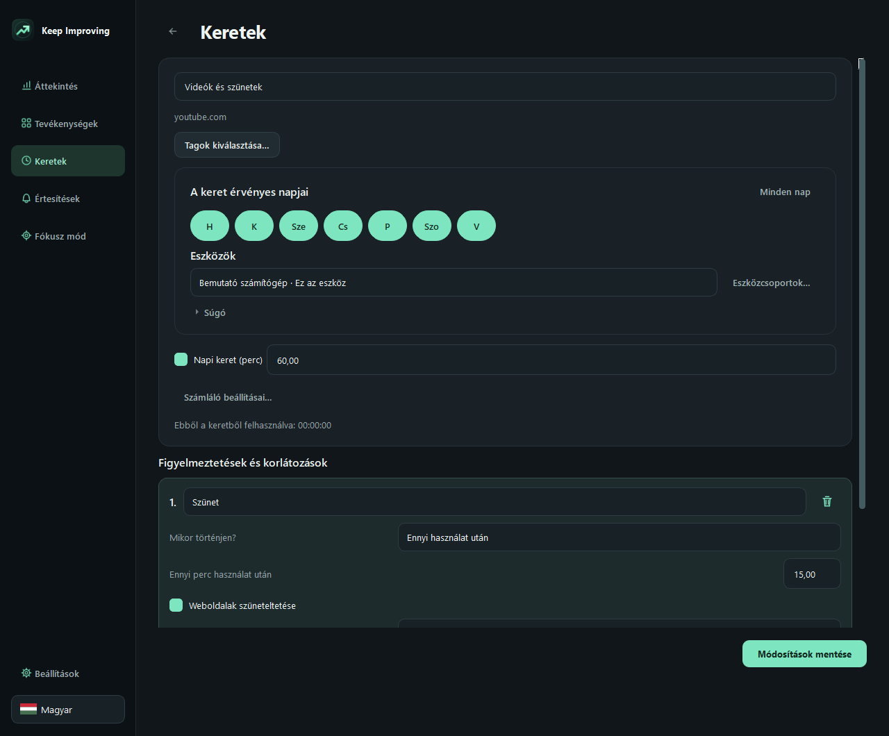
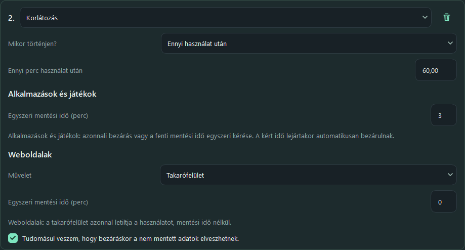
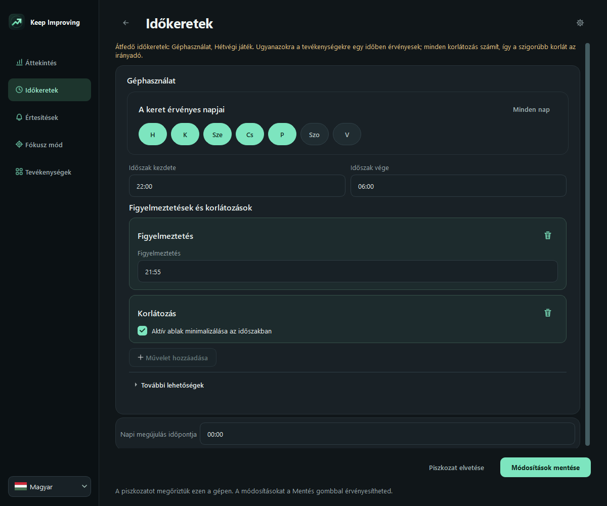

# Keep Improving — 2.39.27

**[Letöltés Windows x64-re — 2.39.27](https://github.com/Blintboi/windows-game-time-monitor/raw/refs/heads/main/downloads/GameTimeMonitor-Setup.exe)** · [SHA-256 ellenőrzőösszeg](downloads/GameTimeMonitor-Setup.exe.sha256) · [English](README.md)

**[Android telepítő letöltése — 0.1.0 előzetes (.apk)](https://github.com/Blintboi/keep-improving/raw/refs/heads/main/downloads/KeepImproving-Android.apk)** · [SHA-256 ellenőrzőösszeg](downloads/KeepImproving-Android.apk.sha256) · [Android telepítési útmutató](android/README.hu.md)

**Android 8.0 vagy újabb:** nyisd meg ezt az oldalt a telefonodon, töltsd le a fenti APK-t, majd nyisd meg a telepítéshez. Az előzetes méri a telefon alkalmazáshasználatát, és szinkronizálja a statisztikákat a számítógépeiddel. Telefonos időkorlátokat és tiltást még nem tartalmaz.

Lásd, mire megy el a gép előtt töltött időd, szabj határt a használatnak, és iktass be szüneteket. A Keep Improving játékokat, alkalmazásokat és weboldalakat mér, egyéni vagy közös időkeretekkel, emlékeztetőkkel és fókuszidőzítővel. Ingyenes, nyílt forráskódú, magyar és angol felülettel.

*Minden képernyőkép a 2.39.21-es verzióból, külön bemutatóprofillal készült. Az időadatok és keretek szemléltető példák. A játékok képei a tulajdonosaikhoz tartoznak.*

## Első lépések

1. **Windows 11 x64** rendszeren futtasd a fenti telepítőt. Normál telepítéshez nem kell Python vagy rendszergazdai jogosultság.
2. A **Tevékenységek** oldalon nézd át a játékokat, alkalmazásokat és weboldalakat. A hiányzó játékot a futtatható fájljával adhatod hozzá. Nyelvet az oldalsáv alján választhatsz.
3. Az **Időkeretek → Új hozzáadása** alatt válaszd ki, mire vonatkozzon a keret. Játékok, alkalmazások és weboldalak közös csoportba is kerülhetnek.
4. Add meg az érvényes napokat és a napi keretet, majd a kívánt műveleteket. A közös napváltást a **Beállítások → Általános** oldalon adhatod meg. Új profilnál nincs kötelező alapkeret.
5. Weboldalak méréséhez és korlátozásához [csatlakoztasd a böngészőbővítményt](#böngészőbővítmény).

Az ablak bezárása után a program a tálcán fut tovább. Teljes leállításhoz válaszd a kilépést a tálcaikon menüjében. A program a Windowszal együtt indul, a frissítés pedig megőrzi a profilodat.

A telepítő jelenleg **nincs digitálisan aláírva**. Részletek a [Windows-bizalmi útmutatóban](docs/WINDOWS-TRUST.hu.md); jelzett fájl telepítéséhez ne kapcsold ki a vírusvédelmet.

## Állítsd össze a saját időkereteidet

Minden keretnek saját **napválasztója** és opcionális **perces kerete** van. Minden keret a **Beállítások → Általános** oldalon megadott egyetlen **Napváltás** időpontját követi. Eltérő hétvégi beállításhoz hozz létre másik keretet a megfelelő napokkal. A szerkesztő jelzi az átfedéseket; minden érvényes korlátozás számít.

A művelet történhet **megadott percnyi használat után** vagy **napi óraidőpontban**. Például 06:00-s megújulással és 22:00-s korlátozással ebben az időablakban engedheted a használatot. A perces keret kikapcsolható, ha az időablak önmagában elég. A bekapcsolt **0 perces keret azonnal tilt**, külön korlátozó művelet nélkül.

A félbehagyott módosítások helyi **piszkozatként megmaradnak**, elnavigálás és újraindítás után is. A **Módosítások mentése** érvényesíti, a **Piszkozat elvetése** megerősítés után törli őket. Az általános beállításokra ez nem vonatkozik. Egy keret törlése és mentése nem törli a mért előzményeket.

A **Művelet hozzáadása** gombbal válaszd ki, mi történjen. Vegyes keretnél egy műveleten belül külön állíthatod be az alkalmazások/játékok és a weboldalak működését. Csak a keretben szereplő típusok beállításai jelennek meg.

| Művelet | Alkalmazás és játék | Weboldal |
| --- | --- | --- |
| Figyelmeztetés | Hang, felugró értesítés vagy mindkettő | Hang, felugró értesítés vagy mindkettő |
| Szünet | Minimalizálás, kitakarás és némítás vagy bezárás a szünet idejére | Takarófelület, átirányítás vagy a lap bezárása |
| Korlátozás | Azonnali bezárás vagy egyszer kérhető mentési idő, utána automatikus bezárás | Takarófelület, átirányítás vagy a lap bezárása |

A használathoz kötött **szünet ismétlődik** újabb ugyanennyi használat után, amíg van idő a keretben. Valós időben telik, akkor is, ha közben mást használsz. A már futó szünet újraindítás és napi megújulás után is megmarad. Weboldal átirányításához megadhatsz HTTP- vagy HTTPS-címet; üresen hagyva új lap nyílik. A szünet után az eredeti oldal ismét megnyitható, ha más aktív korlát nem tiltja.

Alkalmazásbezárásnál az **egyszeri mentési idő 0–60 perc** lehet. A 0 azonnali bezárást jelent. Egyébként kérheted a megadott időt, vagy rögtön bezárhatod az alkalmazást; mentés közben újra használható, az idő lejártakor pedig automatikusan bezárul. Weboldalnál a hosszabbítás az eredeti lapra vonatkozik. Újraindítással nem kérhető újra. Több korlátozásnak is engednie kell a mentési időt, és a legrövidebb érvényesül. Egyidejű korlátozás és szünet esetén a korlátozás az erősebb; a szünet is engedi a jóváhagyott mentési időt.

Bezáráskor elveszhet a nem mentett munka, ezért ehhez külön tudomásulvétel tartozik a szerkesztőben. A rendszerfolyamatok, játékindítók és felismert védett játékok kivételeket képeznek; a teljes képernyős működés és némítás az alkalmazástól is függ. A régebben mentett műveletek viselkedése átállításig megmarad. [Részletes működés](docs/RESTRICTION-PLAN.hu.md). A program személyes időkezelő, nem kijátszhatatlan szülői felügyelet.

Példák: külön keretek, vegyes szünet és mentési idő

*Egy helyen az egyéni és közös keretek, külön hétvégi beállítással is.*

*30 perc használat után: a játék kitakarása és némítása, a weboldalak átirányítása, öt perc szünet.*

*60 perc után: az alkalmazásban egyszer három perc kérhető a mentéshez; a weboldalak rögtön tiltva lesznek.*

Külön **géphasználati időszakokat** is hozzáadhatsz. Válaszd ki a napokat, a kezdő és záró időt, majd adj hozzá figyelmeztetést vagy ablakminimalizálást. Például egy 22:00–06:00 közötti korlátozó időszak 21:55-kor emlékeztethet, éjszaka pedig minimalizálhatja az aktív ablakot. Több, eltérő nevű és napokon érvényes időszak is lehet.

Példa géphasználati időszakra

## Számlálók és értesítések

A számláló **a következő eseményig hátralévő időt** mutatja nagyban, alatta a teljes napi keret maradékát, ha az eltér. Az azonos idő csak egyszer, a nagyobb számlálón jelenik meg. Egy órás keretnél, 30 percenkénti szünettel először a szünetig számol vissza. A futó szünet a tálcaikon fölött és a keretnévvel felsorolt időzítők menüjében is követhető, új lapra átirányítás után is.

A **Számláló beállításai…** alatt megadható a láthatóság, hely, méret és szín. A csoport alapbeállítása mellett minden tag külön beállítható. Játékokhoz a külön telepített **RTSS 7.3.7 vagy újabb** is használható, ahol támogatott. Az **Értesítések** oldalon kikapcsolható a **Részletes RTSS-számláló**: ekkor az RTSS-számlálón csak a következő eseményig tartó idő látszik. Az asztali és tálcás részletek megmaradnak. [Anti-cheat és kompatibilitási útmutató](docs/ANTICHEAT.hu.md).

Az **Értesítések** oldalon minden emlékeztető ugyanúgy szerkeszthető. Feltétele lehet egy időpont, a Keep Improving indulása, napi Pomodoro-cél elérése, illetve játékkerethez vagy lefekvéshez kapcsolódó esemény. A napi cél a befejezett fókuszköröket számolja, és a közös napváltást követi. Választhatsz kész ikont vagy saját képet, másodpercben megadott automatikus vagy kizárólag kézi bezárást. Az értesítés gombjával helyi alkalmazást nyithatsz meg vagy Pomodorót indíthatsz. A Pomodoro időzítése a felugró értesítésben is módosítható; az aktuális fókusz-tiltólistát használja, futó időzítőt nem ír felül. A kezelést igénylő értesítések megvárják, amíg az asztalon használhatók a gombjaik.

Az **Új hozzáadása**, a szerkesztés és a kártyák törlésgombja után a **Módosítások mentése** érvényesíti a változtatásokat. A félbehagyott piszkozat navigálás és újraindítás után is megmarad. Minden emlékeztető törölhető és újra létrehozható; az időkeretek és az előzmények megmaradnak. A korlátozás **nem kapcsol be automatikus lejárati figyelmeztetést**: ehhez adj hozzá külön **Figyelmeztetés** műveletet. A mentési idő kérésére szolgáló ablak a beállítása szerint jelenik meg.

A Pomodoro rövid és hosszú szünete, valamint körszáma 0-ra is állítható a Fókusz oldalon, az értesítés szerkesztőjében és a felugró értesítésben. A 0 kör egyetlen, tetszőleges támogatott pozitív hosszúságú fókuszszakaszt jelent: 00:00-n megáll, és feloldja a tiltásokat. A 0 perces szünet kimarad. A befejezett fókusz beleszámít a napi értesítési célba. Hibás fókuszhossznál üzenet jelenik meg, a beírt érték megmarad. Az értesítés gombjához kereshető listából választhatsz felismert vagy a Windowsban regisztrált alkalmazást; a többi programhoz a tallózás is elérhető. A kiválasztás még nem indítja el az alkalmazást.

## Áttekintés: mire ment el az idő?

Szűrj tevékenységtípusra, időszakra és gépre, válassz napot a részletekhez, keress a listában, vagy vond össze az azonos nevű tételeket. Az **Áttekintés megjegyzi a választásaidat** ezen a gépen, a szűrőket és az összevonás jelölőnégyzetét is. A relatív időszakok mindig az aktuális naphoz igazodnak.

*Szemléltető hétnapos előzmény a bemutatóprofilból.*

Csak az előtérben lévő tevékenységet méri. Az olvasás és a játékmenü bevitel nélkül is számít; a háttérben hagyott alkalmazás, zárolás és alvás nem. A Windows Intéző és rendszerhéj inaktív. A weboldalidő a böngészőidő része, így egyszer számít bele. A bővítmény a Brave felismert új lapját inaktívnak tekinti; más, azonosítatlan böngészőidő megmaradhat az összesítésben.

Privát lapok domainjét, oldalcímeket és oldaltartalmat nem rögzít. Az alkalmazások és webhelyek mérése kikapcsolható. Egy alkalmazás kizárása elrejti a korábbi adatait és leállítja az új mérést; a játékok kizárása ettől külön működik. A **Beállítások → Általános → Napváltás** a statisztika, minden keret és a napi értesítések közös naphatárát adja meg. Módosításkor a már felhasznált idő megmarad; a régi napi összesítések pontos időbélyegek nélkül nem oszthatók újra visszamenőleg.

## Böngészőbővítmény

A bővítmény ikonjáról gyorsan indíthatod vagy szüneteltetheted a fókuszt, láthatod az aktuális visszaszámlálást, és időkerethez vagy fókusztiltáshoz adhatod a megnyitott weboldalt. A **Kezelőfelület megnyitása** gomb teljes böngészőlapon nyitja meg az Áttekintés, Tevékenységek, Időkeretek, Értesítések, Fókusz mód és Beállítások oldalakat. Innen is elérheted a statisztikákat, kezelheted a játékokat és alkalmazásokat, szerkesztheted a kereteket és emlékeztetőket, indíthatsz Pomodorót és összekapcsolhatod a számítógépeket. A két felület ugyanazt a futó asztali programot és profilt használja; a mentések mindkét helyen azonnal érvényesek.

A kezelőfelület magyarul és angolul is használható, helyben megőrzi a félbehagyott szerkesztések piszkozatait, frissítéskor pedig a megnyitott kezelőlapokat is visszaállítja. Az asztali programnak futnia kell. Ha nem érhető el, a bővítmény kapcsolódási üzenetet mutat.

Brave, Chrome és Edge esetén:

1. Fusson a program; nyisd meg a **Tevékenységek → Weboldalak → Böngésző csatlakoztatása** ablakot.
2. Nyisd meg a `brave://extensions`, `chrome://extensions` vagy `edge://extensions` oldalt, és kapcsold be a **Fejlesztői módot**.
3. A **Kicsomagolt bővítmény betöltése** gombbal válaszd ki a program által mutatott `browser_extension` mappát.
4. A bővítmény ikonjáról nyisd meg a kezelőfelületet. A kapcsolódási képernyőbe illeszd be az alkalmazás párosítási kódját, válaszd ki a böngészőt, és csatlakozz.
5. Ismételd meg minden használt böngészőben és profilban. A párosítási kód maradjon titkos.

A 2.39.23-as verziótól a párosított bővítmény az alkalmazás befejezett frissítése után automatikusan újratöltődik, megőrizve a párosítást és a kitakart oldalakat. A meglévő helyi kapcsolatot használja, külön frissítési lapot nem nyit. A korábban betöltött régi példány egyszeri újratöltést igényel: nyisd meg a kapcsolódási oldalát, vagy indítsd újra a böngészőt. A visszatérési címek a böngésző helyi tárolójában maradnak, így újraindítás után is helyreállíthatók; nem kerülnek az asztali statisztikába. A bővítmény kikapcsolása leállítja a webmérést és webtiltást; kapcsolathibánál a böngészős korlátozás megszűnik.

## Fókusz és összekapcsolt gépek

A **Fókusz mód** állítható munkaidőt, rövid és hosszú szüneteket kínál. Munka közben tiltja a kiválasztott webhelyeket, és minimalizálja az előtérbe kerülő kijelölt alkalmazásokat. A **Csoportok** fülön teljes időkeretcsoportokat vagy kategóriákat is hozzáadhatsz: a tiltás az aktuális alkalmazás-, játék- és weboldaltagjaikat követi. Szüneteltetés, leállítás és pihenő feloldja ezeket a fókuszkorlátozásokat. Egy időkeret mentési ideje nem ír felül külön aktív fókusztiltást. A befejezett körök száma az ezen a gépen eddig befejezett összes kört mutatja, a korábbi napokkal és munkamenetekkel együtt.

A **Tevékenységek** az oldalsáv második helyén található, közvetlen **Játékmappák** gombbal. A játékok összesítője a napi játékkeretből hátralévő időt mutatja. A globális beállításokat az oldalsáv **Beállítások** fülén találod.

A fókuszhoz hozzáadott csoportok tagjai a **Weboldalak** és az **Alkalmazások** között is megjelennek, a forráscsoportjaikkal együtt. A közös tagok csak egyszer szerepelnek. A lista követi a csoportok módosításait; az örökölt tagokat az **Időkeretek** alatt módosíthatod, a teljes csoportot a **Csoportok** fülön veheted ki.

Fókuszidőzítő és weboldallista

*Példalista a böngésző csatlakoztatása előtt; a weboldaltiltáshoz csatlakoztatni kell a bővítményt.*

Saját gépeidet az **Áttekintés → Gépek és szinkron** alatt kapcsolhatod össze. Az első gépen lépj be GitHubbal, a többin használd az ott kapott kapcsolati kódot. A kód hozzáférést ad a közös adatokhoz, ezért tartsd titokban. Az előzmények és támogatott beállítások feltöltés előtt a gépen titkosítódnak.

A közös játékkeret és a játékonkénti keretek a szinkronizált játékidőt is számolják; az egységes elszámoláshoz frissíts minden kapcsolt gépet. A többi tevékenység kerete, a korlátozási lépések és mentési hosszabbítások helyiek maradnak. A kérések között legalább tíz perc telik el; a korlát UTC-naponként 20, havonta 600 sikeres kérés. A távoli előzmény késhet vagy internet nélkül hiányozhat; a helyi mérés internet nélkül is folytatódik.

## Adatok, frissítés és segítség

A profil a `Documents\GameTimeMonitor\data` mappában van. Biztonsági másolathoz lépj ki a programból, és másold a teljes mappát. Az eltávolítás megőrzi. A helyi előzmények nincsenek titkosítva. Nincs reklám vagy általános analitikai követés: [adatvédelem](PRIVACY.md), [biztonság](SECURITY.md).

A frissítésellenőrzés legfeljebb naponta egyszer kapcsolódik a GitHubhoz, és kikapcsolható. Te döntöd el, mikor töltesz le és telepítesz. Az elsődleges letöltés a README tetején található közvetlen telepítőlink.

Hibát a [GitHub Issues](https://github.com/Blintboi/keep-improving/issues) oldalon jelezhetsz, kódok, tokenek és profiladatbázis nélkül. További információ: [MIT-licenc](LICENSE), [külső összetevők](THIRD-PARTY-NOTICES.md), [fejlesztés](docs/DEVELOPMENT.md), [felépítés](ARCHITECTURE.md), [tesztelés](TESTING.md).
