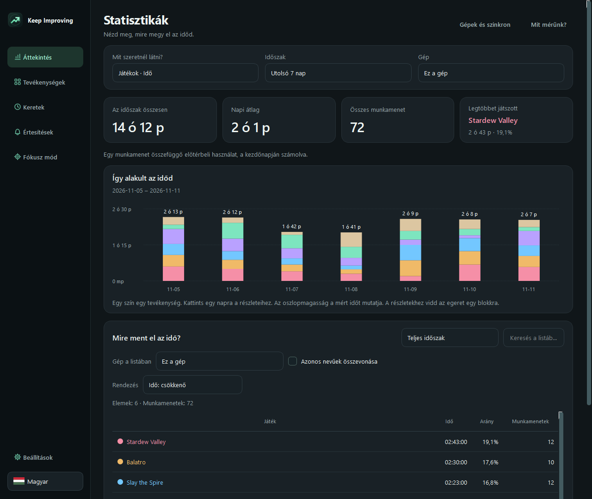
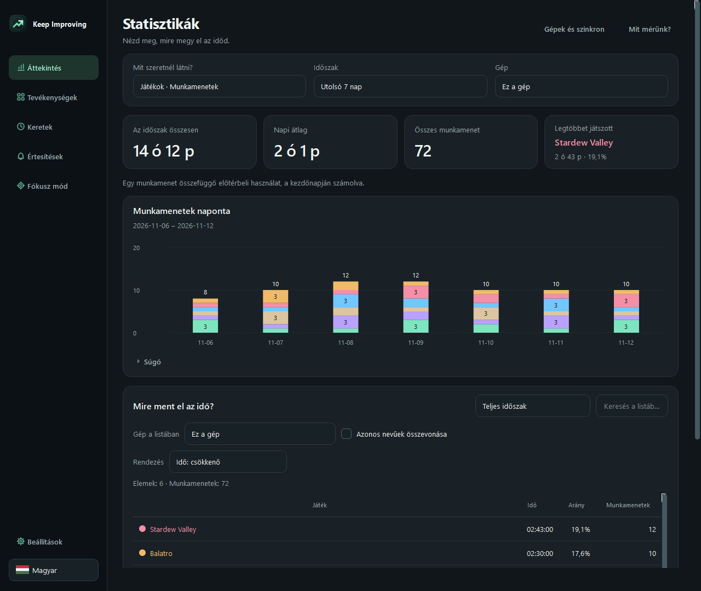
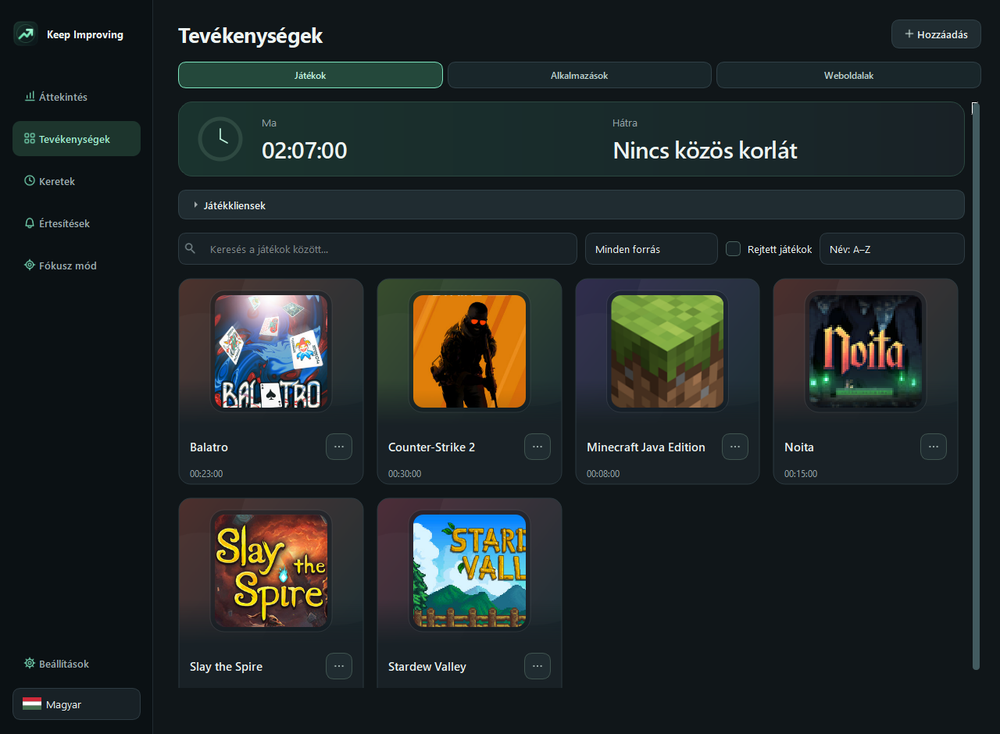
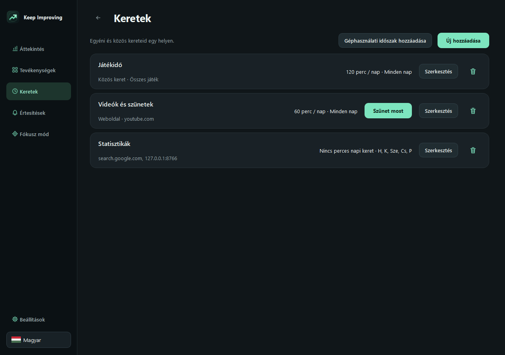
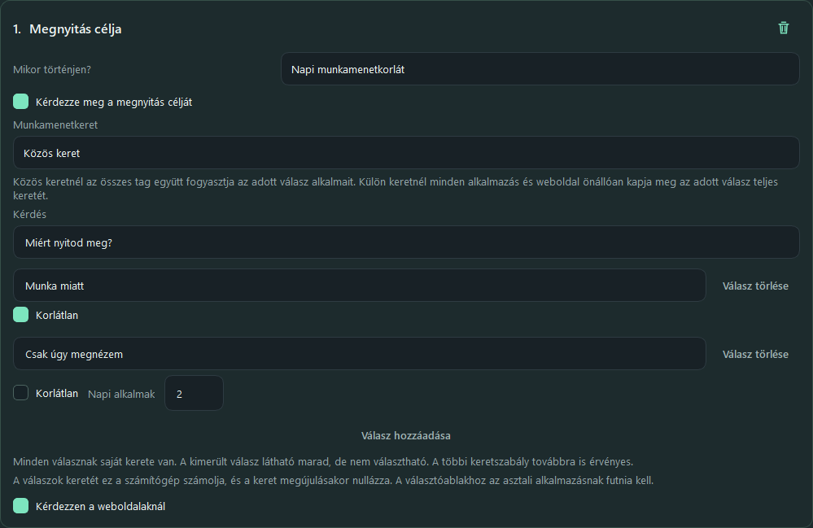
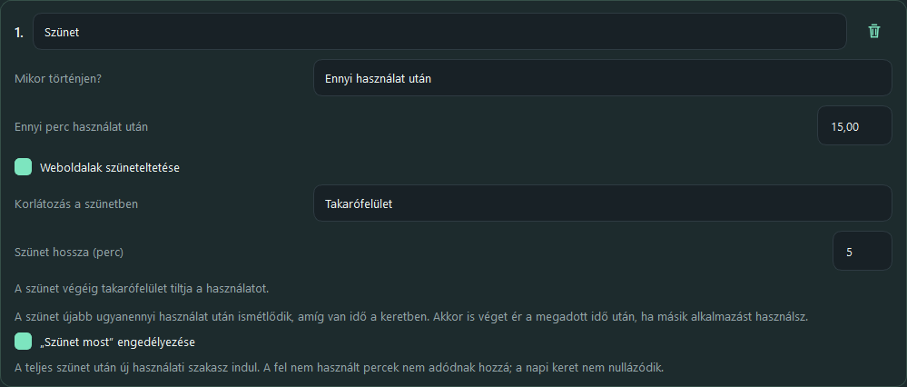
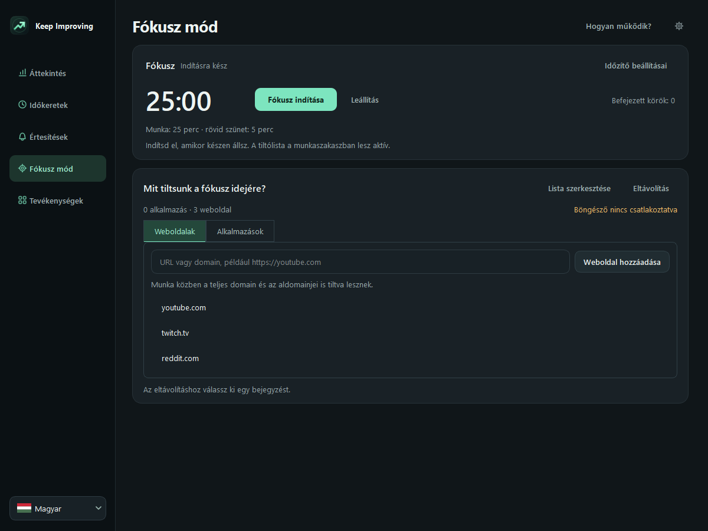

# Keep Improving — 2.46.1

**[Letöltés Windows x64-re — 2.46.1](https://github.com/Blintboi/windows-game-time-monitor/raw/refs/heads/main/downloads/GameTimeMonitor-Setup.exe)** · [SHA-256](downloads/GameTimeMonitor-Setup.exe.sha256) · [English](README.md)

**[Android telepítő — 0.6.0 (.apk)](https://github.com/Blintboi/keep-improving/raw/refs/heads/main/downloads/KeepImproving-Android.apk)** · [SHA-256](downloads/KeepImproving-Android.apk.sha256) · [Telefonos útmutató](android/README.hu.md)

Lásd, mire megy el az időd, döntsd el, milyen gyakran térsz vissza, és iktass be szüneteket. A Keep Improving az előtérbeli használatot méri, időkereteket, napi munkamenetkorlátokat, emlékeztetőket és fókuszidőzítőt kínál. Ingyenes, nyílt forráskódú, magyar és angol felülettel.

*A képek az aktuális Windows-alkalmazásból, külön bemutatóprofillal készültek. Minden időadat, keret és választás példa; személyes előzmény és kapcsolódási kód nem szerepel rajtuk.*

## Első lépések

1. Telepítsd **Windows 11 x64** rendszerre. Normál telepítéshez nem kell Python vagy rendszergazdai jogosultság. A frissítés megőrzi a profilodat.
2. A **Tevékenységek** alatt nézd át a játékokat, alkalmazásokat és weboldalakat. Hiányzó játékot a futtatható fájljával adhatsz hozzá.
3. A **Keretek → Új hozzáadása** alatt válaszd ki a tagokat, az érvényes napokat és a kívánt korlátokat vagy emlékeztetőket. Keresés közben is látható marad, mit jelöltél már ki.
4. Weboldalakhoz [csatlakoztasd a böngészőbővítményt](#böngészőbővítmény). Android 8.0 vagy újabb telefonra telepítsd az APK-t a [telefonos útmutató](android/README.hu.md) szerint.

Az ablak bezárásakor a Windows-program a tálcán fut tovább. A **Kilépés a figyelőből** leállítja. Új profilban nincs kötelező keret. A Windows-telepítő nincs digitálisan aláírva; lásd a [Windows bizalmi útmutatóját](docs/WINDOWS-TRUST.hu.md).

## Értsd meg a használatodat

Az **Áttekintés** diagramján idő vagy **munkamenetszám** is megjeleníthető. A **Mit szeretnél látni?** listában válaszd ki a tevékenységtípust és a mértéket, majd szűrj időszakra és eszközre. A tevékenységlista kereshető, idő és munkamenetszám szerint rendezhető; az azonos nevek összevonhatók. A szűrők megmaradnak.

Egy munkamenet összefüggő, mért előtérbeli használat, a kezdőnapján számolva. Az alkalmazás azt a darabszámot mutatja, amit mérni tudott; régebbi előzményekhez nem talál ki alkalmakat. Csak az előtér számít: az olvasás és a játékmenü igen, a zárolás, alvás és háttérben hagyott alkalmazás nem. A weboldalidő a böngészőidő része, nem adódik hozzá még egyszer.

Munkamenetdiagram és tevékenységtár

*A játékok képei a tulajdonosaikhoz tartoznak.*

## Állíts a tevékenységhez illő kereteket

Egy kerethez egyetlen tevékenység, több játék, alkalmazás vagy weboldal, illetve teljes kategória is tartozhat. Állítsd be az **érvényes napokat**, az opcionális napi perckeretet és a műveleteket. A napi keretek a **Beállítások → Általános → Napváltás** szerint újulnak meg. Nulla perces kerettel azonnal tilthatsz; a perckeretet ki is kapcsolhatod, ha másfajta korlátot szeretnél.

| Mikor történjen? | Példa |
| --- | --- |
| Összegyűlt használati idő után | Minden tizenöt perc használat után öt perc szünet. |
| Napi időponttól | Korlátozás 22:00-tól. |
| Napi munkamenetkorlátnál | Öt megnyitás engedélyezett; a hatodik indítja a műveletet. |

Válassz **figyelmeztetést**, **szünetet** vagy **korlátozást**. Játékoknál és alkalmazásoknál minimalizálás, kitakarás és némítás, illetve bezárás használható a támogatott módok szerint. Weboldalnál kitakarás, átirányítás vagy lapbezárás választható. Vegyes keretben külön állítható az alkalmazások és weboldalak viselkedése. A bezárást külön jóvá kell hagyni, és egyszeri mentési idő is adható. Az átfedő korlátok együtt érvényesek.

### Kérdezd meg magadtól, miért nyitod meg

A **Napi munkamenetkorlát** alatt kapcsold be a **Kérdezze meg a megnyitás célját** lehetőséget. Saját kérdés és 2–8 válasz adható meg. Minden válasz lehet korlátlan vagy napi alkalomszámhoz kötött: például a „Munka miatt” korlátlan, a „Csak úgy megnézem” napi kettő. A kimerült válasz látható marad, de letiltódik.

A **Közös keret** az összes tag között osztja el az adott válasz alkalmait; a **Tagonként külön keret** minden alkalmazásnak és weboldalnak saját keretet ad. Ezek az alkalmak ezen a számítógépen tárolódnak, és újraindítás után is megmaradnak. Weboldalnál a kérdés a megnyitott oldal fölött jelenik meg; párosított bővítmény és futó asztali alkalmazás szükséges.

### Kezdj szünetet korábban

Ismétlődő, használati időhöz kötött szünetnél bekapcsolható a **„Szünet most” engedélyezése**. A gomb az alkalmazás és a bővítmény **Keretek** listájában, az adott keret sorában jelenik meg; a bővítmény felugró ablakából és a tálcamenüből is elérhető. A lebegő visszaszámlálón nincs gomb.

A teljes szünet után új teljes használati szakasz indul. Egy 15 perc használat / 5 perc szünet szabálynál a 12. percben indított szünet is öt percig tart, majd új tizenöt perc következik. A megmaradt percek nem adódnak hozzá, a napi keret nem nullázódik. A futó szünet újraindítás után is megmarad.

### Helyi weboldalt is hozzáadhatsz

A tagválasztóban megadhatsz például `http://127.0.0.1:8766/` címet. A `localhost:8766` és a `[::1]:8766` ugyanahhoz a kerethez számít; más port külön weboldal. Helyi címet csak akkor mér, ha külön hozzáadod egy kerethez vagy a fókusz tiltólistájához. URL-útvonal, paraméter és oldaltartalom nem kerül a használati előzménybe.

A félbehagyott keretszerkesztés helyi piszkozatként megmarad a **Módosítások mentése** vagy a **Piszkozat elvetése** műveletig. A keret törlése megőrzi az előzményeket. Önálló **géphasználati időszakot** is felvehetsz érvényes napokkal, kezdő- és záróidővel, figyelmeztetéssel és ablakminimalizálással.

## Fókusz, emlékeztetők és visszaszámlálás

A **Fókusz mód** állítható Pomodorót kínál, munka közben a kiválasztott alkalmazások, weboldalak és keretcsoportok korlátozásával. Szüneteltetés, leállítás és pihenő feloldja a fókuszkorlátozást. Nulla kör egyetlen fókuszszakaszt jelent; a nulla perces szünet kimarad.

Az **Értesítések** között időponthoz, programinduláshoz és napi teljesített fókuszcélhoz kapcsolódó emlékeztetők állíthatók be. Kérhetsz hangot, saját ikont és időzítőt vagy alkalmazást indító gombot. Az emlékeztetők a korlátozásoktól külön állíthatók.

A számláló a következő eseményig hátralévő időt és – ha eltér – a napi maradékot mutatja. A **Számláló beállításai…** alatt módosítható a láthatóság, hely, méret és szín. Támogatott játékoknál külön telepített RTSS is használható; lásd az [anti-cheat és kompatibilitási útmutatót](docs/ANTICHEAT.hu.md).

## Böngészőbővítmény

**Brave, Chrome és Edge** esetén:

1. A futó programban nyisd meg a **Tevékenységek → Weboldalak → Böngésző csatlakoztatása** ablakot.
2. A böngésző bővítménykezelőjében kapcsold be a **Fejlesztői módot**.
3. A **Kicsomagolt bővítmény betöltése** gombbal válaszd ki a program által mutatott `browser_extension` mappát.
4. A bővítmény **Böngésző csatlakoztatása** oldalán add meg a párosítási kódot és válaszd ki a böngészőt. A kód maradjon titkos.
5. Ismételd meg minden használt böngészőben és profilban. A **Kezelőfelület megnyitása** teljes böngészőlapon nyitja meg a felületet.

Az alkalmazás és a böngészős kezelőfelület ugyanazt a profilt használja. Frissítés után a párosított bővítmény automatikusan újratöltődik, megőrizve a párosítást és a kitakart oldalak visszaállítását. Az asztali program leállásakor a **Böngészős mód** a tárolt webes korlátokkal, böngészőméréssel és fókuszidőzítéssel tovább működhet. Visszakapcsolódáskor a pótolt használat egyszer kerül be. A beállítások szerkesztéséhez, a megnyitási kérdésekhez és más Windows-alkalmazások vezérléséhez futó asztali program kell. A bővítmény kikapcsolása leállítja a webes mérést és korlátozást.

## Telefon és más számítógépek

Az Android-alkalmazás saját alkalmazásmérést, munkamenetkorlátokat, szüneteket, fókuszidőzítőt és emlékeztetőket kínál. A számítógépek weboldal-előzményeit is megjeleníti, de a telefon saját böngészőjét alkalmazásként méri. A méréshez használati hozzáférés, a gyors korlátozáshoz az opcionális kitakarási szolgáltatás szükséges. A Windows megnyitási célválasztója és „Szünet most” gombja Androidon még nem érhető el. [Telefonos funkciók és engedélyek](android/README.hu.md).

Windows alatt az **Áttekintés → Gépek és szinkron**, Androidon a **Beállítások → Eszközök és szinkron** részen kapcsolhatsz össze eszközöket. A kapcsolati kód létrehozásához GitHub-belépés szükséges; a többi eszközön ugyanezt a kódot használd. Az előzmények és a támogatott beállítások feltöltés előtt titkosítódnak. A kódot tartsd titokban.

A keret egy eszközre, eszközcsoportra vagy minden kapcsolt eszközre vonatkozhat. A kijelölt eszközök közös keretet fogyasztanak; a párhuzamos használat összeadódik. Az Android-alkalmazást és a Windows-programot külön kell kijelölni. A távoli használat és szerkesztés szinkronizálás után érkezik meg. Kapcsolat nélkül az utolsó átvett összesítés számít, ezért a közös határ átmenetileg túlléphető. A felület mutatja a szinkron állapotát; a háttérbeli kézbesítést az Android ütemezése és a szolgáltatás kvótái is befolyásolják.

## Adatok, frissítés és segítség

A Windows-profil a `Documents\GameTimeMonitor\data` mappában van. Mentéshez lépj ki a figyelőből, és másold le a teljes mappát; az eltávolítás megőrzi. A helyi előzmény nincs titkosítva. Nincs reklám vagy általános analitikai követés. Privát lapok domainjét, oldalcímeket és oldaltartalmat nem rögzít. [Adatvédelem](PRIVACY.md), [biztonság](SECURITY.md).

A frissítésellenőrzés legfeljebb naponta egyszer kapcsolódik a GitHubhoz, és kikapcsolható. Te döntöd el, mikor telepítesz. Az elsődleges letöltések a lap tetején található közvetlen telepítőlinkek.

Ez önkéntes, személyes időgazdálkodási eszköz. Hibát a [GitHub Issues](https://github.com/Blintboi/keep-improving/issues) oldalon jelezz, kódok, tokenek és profiladatbázis nélkül. További információ: [MIT-licenc](LICENSE), [külső összetevők](THIRD-PARTY-NOTICES.md), [fejlesztés](docs/DEVELOPMENT.md), [felépítés](ARCHITECTURE.md), [tesztelés](TESTING.md).
