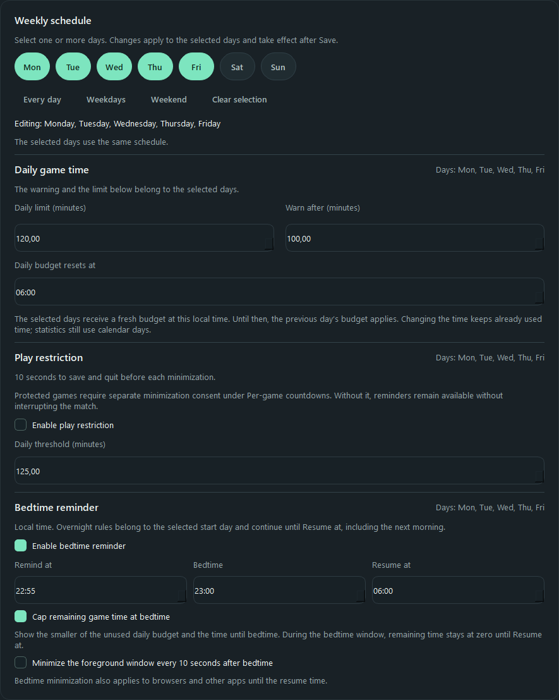

# Keep Improving — 2.39.20

**[Letöltés Windows x64-re — 2.39.20](https://github.com/Blintboi/windows-game-time-monitor/raw/refs/heads/main/downloads/GameTimeMonitor-Setup.exe)** · [SHA-256 ellenőrzőösszeg](downloads/GameTimeMonitor-Setup.exe.sha256) · [English](README.md)

A Keep Improving megmutatja, mire megy el a gép előtt töltött időd, és segít saját kereteket beállítani. Játékokat, alkalmazásokat és weboldalakat mér, egyéni vagy közös időkereteket, emlékeztetőket és fókuszidőzítőt kínál. Ingyenes, nyílt forráskódú, magyar és angol felülettel.

*A jelenlegi felület a fejlesztő valódi játéktárával. A játékok képei a tulajdonosaikhoz tartoznak.*

## Első lépések

1. **Windows 11 x64** rendszeren futtasd a fenti telepítőt. Normál telepítéshez nem kell Python vagy rendszergazdai jogosultság.
2. Nyisd meg a **Keep Improving** alkalmazást. A nyelvet az oldalsáv alján választhatod ki.
3. Nézd át a játékokat és tevékenységeket. A hiányzó játékot a futtatható fájljával adhatod hozzá.
4. Az **Időkeretek → Új hozzáadása** alatt válassz játékot, alkalmazást, weboldalt vagy közös keretet használó csoportot. Új profilnál nincs kötelező alapkeret.
5. A weboldalak méréséhez és tiltásához [csatlakoztasd a böngészőbővítményt](#böngészőbővítmény).

Egy keret törléséhez kattints a mellette lévő kukára, majd a **Módosítások mentése** gombra. A rögzített előzmények megmaradnak.

Minden oldalnak saját beállításgombja van. A **nap kezdete** a statisztika és az alapértelmezett keretek napváltását adja meg, éjfél helyett például 01:00-kor. Az egyes időkeretek szerkesztőjében ettől független napi megújulási időt is választhatsz. A beállítás módosításakor a program továbbviszi a már felhasznált időt; a régi napi összesítések pontos időbélyegek hiányában nem oszthatók újra visszamenőleg. A régebbi alkalmazásverziót futtató kapcsolt gépek adatai átmenetileg a teljes átfedő napokkal számítanak, amíg azokat is nem frissíted.

A főablak bezárása után a program a tálcán fut tovább; teljes leállításhoz válaszd a kilépést a tálcaikon menüjében. A frissítés megőrzi a profilodat. A program a Windowszal együtt indul.

A telepítő jelenleg **nincs digitálisan aláírva**. Az aláírás későbbre maradt; nincs aktív SignPath-tanúsítvány. Részletek a [Windows-bizalmi útmutatóban](docs/WINDOWS-TRUST.hu.md). Jelzett fájl telepítéséhez ne kapcsold ki a vírusvédelmet.

Az **Áttekintés** megjegyzi ezen a gépen a kiválasztott tevékenységet, időszakot, gépet, napot, listakeresést és az azonos nevűek összevonását. A relatív időszakok, például az utolsó 30 nap, mindig az aktuális naphoz igazodnak.

## Időkeretek: te döntöd el, mi történjen

Nyiss meg egy keretet, válaszd ki a napokat és a napi keretet, majd a **Művelet hozzáadása** gombbal válassz figyelmeztetést vagy korlátozást. A kockák automatikusan időrendbe kerülnek; a korábban bekapcsolt korlátozások is itt láthatók, és eltávolításig érvényben maradnak. Új keretnél az **Összes játék** kiválasztásával a heti közös játékkeretet állíthatod össze; a **Géphasználat · időszak** választással kezdő és záró óraidőt adhatsz meg. Az időszak figyelmeztetése és az ablakok minimalizálása külön adható hozzá vagy távolítható el.

| Művelet | Alkalmazás és játék | Weboldal |
| --- | --- | --- |
| Figyelmeztetés | Hang, felugró értesítés vagy mindkettő | Hang, felugró értesítés vagy mindkettő |
| Szünet | A választott korlátozás a megadott ideig | A választott korlátozás a megadott ideig |
| Korlátozás | Mentési idő kérhető vagy az alkalmazás azonnal bezárható | Tiltóoldal, kérhető mentési idővel |

Keretenként kijelölheted az érvényes napokat. A művelet indulhat megadott percnyi tényleges használat után vagy egy napi óraidőpontban. Az időablak a keret saját megújulásától a választott záróidőig tart; a perces napi keret kikapcsolható, ha az időablak önmagában elég. A bekapcsolt 0 perces keret külön művelet nélkül, azonnal tiltja az elérést. Vegyes keretnél egy műveleten belül külön állíthatod be az alkalmazások/játékok és a weboldalak működését. Az alkalmazásokhoz egyféle új korlátozás választható; a korábban mentett minimalizálás, kitakarás és bezárás változatlan marad, amíg át nem állítod. Ha egy korlátozás és egy szünet egyszerre érvényes, a korlátozás felülete jelenik meg, és mentési idő kérhető, miközben a szünet tovább telik.

A **Szünet** műveletnél megadhatod, mennyi használat után induljon, milyen korlátozást alkalmazzon és hány percig tartson. Weboldalaknál egy általad megadott http vagy https oldalra is átirányíthatod a lapot; ha a címet üresen hagyod, a böngésző új lapja jelenik meg. A céloldalon töltött idő továbbra is megjelenik a tevékenységek között, de a szünetet indító keretet nem fogyasztja. A szünet lejárta után az eredeti oldal ismét megnyitható. A következő szünet újabb ugyanennyi használat után indul, de csak amíg van idő a keretben. A szünet valós időben telik, újraindítás és napváltás után is megmarad; más aktív szabályok a végén is korlátozhatnak. Frissítés után töltsd újra a böngésző bővítményei oldalán a Keep Improving bővítményt is.

Az **egyszeri mentési idő 0–60 perc** lehet. A 0 mentési idő nélküli bezárást jelent. Egyébként a korlátozófelületen keretenként és naponta egyszer kérheted a megadott időt, vagy rögtön bezárhatod az alkalmazást. A számláló mutatja a hátralévő időt, utána az alkalmazás bezárul. Weboldalnál csak az eredeti lap kap hosszabbítást, majd visszatér a tiltás. Több érintett korlátozásnak is engednie kell ezt; a legrövidebb hosszabbítás érvényes. A program újraindítása nem ad újabb lehetőséget.

A bezárás miatt elveszhet a nem mentett munka, ezért a bezárás és a mentési idő engedélyezéséhez jelölőnégyzet tartozik. Rendszerfolyamatokra, játékindítókra és felismert védett játékokra az új kitakarás és bezárás nem alkalmazható. Kizárólagos teljes képernyőn az interaktív felülethez egyszeri minimalizálás lehet szükséges. A némítás az ellenőrzött folyamat normál Windows-hangfolyamaira vonatkozik, nem a rendszer vagy más folyamatok hangjára. [Részletes működés](docs/RESTRICTION-PLAN.hu.md).

A korábban mentett korlátozó műveletek viselkedése megmarad, amíg át nem állítod őket. A játékkeretek, heti beosztás és lefekvési korlát továbbra is használható. A program személyes időkezelő, nem kijátszhatatlan szülői felügyelet.

## Értesítések és számlálók

A keretek **Számláló beállításai…** gombjával megadható a láthatóság, hely, méret és szín; játékokat tartalmazó keretnél az **RTSS használata játékokban** is. A változtatások az időkeret mentésével lépnek életbe, és vele együtt visszavonhatók. A tevékenységek egyéni stílusa elsőbbséget élvez a keret alapbeállításával szemben; a weboldalak és alkalmazások számlálója asztali megjelenítést használ. Minden új műveletválasztóban, weboldalas keretnél is, egyetlen **Korlátozás** választható.

A csoport számlálójánál a **Mihez állítod a számlálót?** listában a **Keret alapbeállítása** mellett külön kiválaszthatod a tagokat. Saját helyet, méretet, színeket és láthatóságot adhatsz nekik; játékoknál az RTSS is külön állítható. A választások közötti váltás megőrzi a módosításokat, a keret szerkesztésének elvetése visszavonja őket.

Az **Értesítések** oldalon együtt látod a beépített emlékeztetőket és a saját üzeneteidet. Egyéni címet, szöveget, ikont, időpontot és napokat adhatsz meg. Az asztali értesítések bezárhatók és mozgathatók. A normál emlékeztető és számláló nem veszi el a billentyűzet fókuszát a játéktól.

A számláló nagyban a következő eseményig hátralévő időt, alatta kisebben a napi keret maradékát mutatja. Szünet alatt annak hátralévő ideje a tálcán követhető, új lapra átirányítás után is. A tálca menüje keretnévvel sorolja fel a futó időzítőket. A korlátozás hozzáadása nem kapcsol be automatikus lejárati figyelmeztetést: a külön beállított figyelmeztetés jelez, a mentési idő kérésére szolgáló ablak pedig akkor jelenik meg, ha engedélyezted.

A számláló megjelenése és helye célonként állítható. Támogatott teljes képernyős játékokhoz a külön telepíthető **RTSS 7.3.7 vagy újabb** használható; ahol lehet, asztali megjelenítés működik. A kompatibilitás a játéktól és a megjelenítési módtól is függ. Védett játékokhoz külön, kifejezett hozzájárulási beállítások tartoznak: [anti-cheat útmutató](docs/ANTICHEAT.hu.md).

## Mi számít bele az időbe?

Csak az előtérben lévő tevékenységet méri. Az olvasás, játékmenü és szünet is számít, akkor is, ha nem mozgatod az egeret. A háttérben hagyott alkalmazás, zárolás és alvás nem számít; a játékindító nem játékidő. A Windows Intéző és rendszerhéj képernyői inaktívnak számítanak, a korábbi alkalmazásstatisztikákból is eltűnnek.

A párosított bővítmény felismeri a nyilvános webhelyek domainjét és a Brave új lapját. A felismert Brave-kezdőlap inaktív. Más, azonosítatlan böngészőidő megmarad: a régi összesített adatokból nem választható külön biztosan a kezdőlap és az olyan oldal, amelynek domainje nem jutott el a programhoz. A weboldalidő a böngészőidő része, nem számítódik hozzá még egyszer.

Privát lapok domainjét, oldalcímeket és oldaltartalmat nem rögzít. Az alkalmazások és webhelyek mérése kikapcsolható. Egy alkalmazás kizárása elrejti a korábbi adatait és leállítja az új mérést; a játékok mérése és kizárása ettől külön működik.

## Böngészőbővítmény

Brave, Chrome és Edge esetén:

1. Fusson a program; nyisd meg a **Tevékenységek → Weboldalak → Böngésző csatlakoztatása** ablakot.
2. A böngészőben nyisd meg a `brave://extensions`, `chrome://extensions` vagy `edge://extensions` oldalt, és kapcsold be a **Fejlesztői módot**.
3. A **Kicsomagolt bővítmény betöltése** gombbal válaszd ki a program által mutatott `browser_extension` mappát.
4. A bővítmény beállításaiban illeszd be az alkalmazásból kimásolt párosítási kódot, válaszd ki a böngészőt, és csatlakozz.
5. Ismételd meg minden használt böngészőben és profilban. A párosítási kód maradjon titkos.

Régebbi verzió frissítése után **töltsd újra a bővítményt**, hogy az új tiltóoldal és navigációs jogosultság is működjön. A kapcsolat helyi. A visszatéréshez szükséges eredeti URL átmenetileg a böngésző munkamenetében marad; nem kerül az asztali programhoz vagy a statisztikai szolgáltatáshoz. A bővítmény kikapcsolása leállítja a webmérést és webtiltást. Kapcsolathibánál a böngészős korlátozás megszűnik.

## Fókusz és statisztikák

A **Fókuszmód** állítható munka- és szünetidőt kínál. Munka alatt a kiválasztott webhelyeket tiltja, az előtérbe kerülő kijelölt alkalmazásokat minimalizálja. Szüneteltetés, leállítás és pihenő feloldja ezt. Az egyszeri mentési idő nem ír felül külön aktív fókusztiltást.

A **Statisztikák** napok és gépek szerint mutatja a játék-, alkalmazás- és webhelyidőt, a böngészés kétszeres számolása nélkül. Opcionálisan összekapcsolhatod saját gépeid előzményeit és támogatott beállításait. Az első gépen a gépek és szinkronizálás ablakában GitHub-belépéssel hozhatsz létre kapcsolatot, a többi gépen annak kódját használhatod. A kód hozzáférést ad a közös adatokhoz, ezért tartsd titokban.

Az adatok feltöltés előtt a gépen titkosítódnak. A közös játékkeret és a játékonkénti keretek az összekapcsolt gépek szinkronizált játékidejét is számolják; ehhez minden gépen frissítsd a programot. A többi tevékenység kerete, a korlátozási lépések és a mentési hosszabbítások helyiek maradnak. A szinkronizálási kérések között legalább tíz perc telik el; a korlát UTC-naponként 20, havonta 600 sikeres kérés. A másik gép legfrissebb ideje késhet, internet nélkül nem érhető el; a helyi mérés internet nélkül is folytatódik.

*Valós, helyben mért játékelőzmények, engedéllyel közzétéve; 2026-10-30-i felvétel. Az időadatok nem generáltak.*

## Adatok és segítség

A profil a `Documents\GameTimeMonitor\data` mappában van. Biztonsági másoláshoz lépj ki a programból, és másold a teljes mappát. Az eltávolítás megőrzi. A helyi előzmények nincsenek titkosítva. Nincs reklám vagy általános analitikai követés: [adatvédelem](PRIVACY.md), [biztonság](SECURITY.md).

A frissítésellenőrzés legfeljebb naponta egyszer kapcsolódik a GitHubhoz, és kikapcsolható. A frissítés böngészővel töltődik le; te döntöd el, mikor telepíted. Az elsődleges letöltés a README tetején található.

Hibát a [GitHub Issues](https://github.com/Blintboi/keep-improving/issues) oldalon jelezhetsz, kapcsolati kód, token és profiladatbázis nélkül. További információ: [MIT-licenc](LICENSE), [külső összetevők](THIRD-PARTY-NOTICES.md), [fejlesztés](docs/DEVELOPMENT.md), [felépítés](ARCHITECTURE.md), [tesztelés](TESTING.md).
