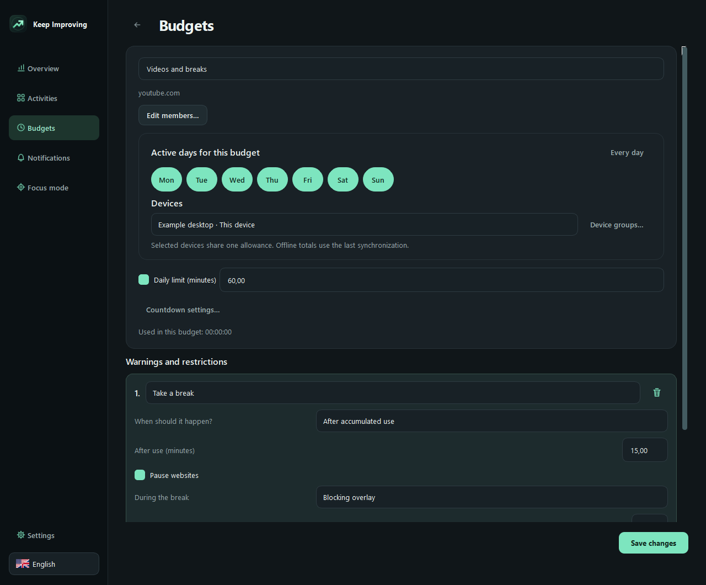
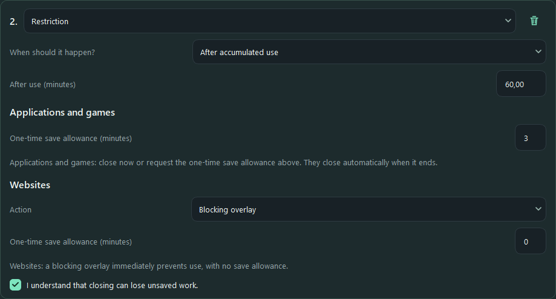
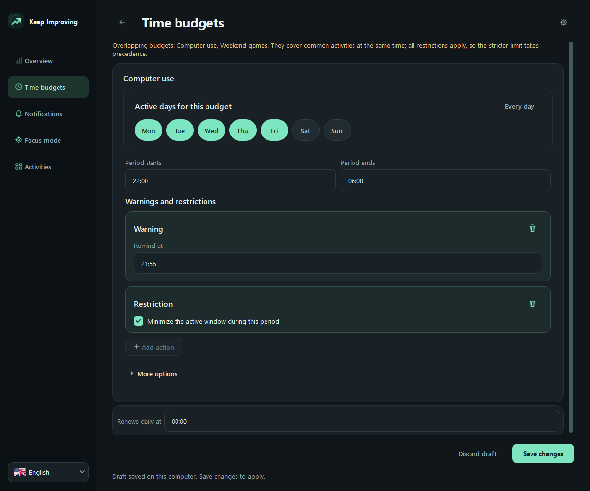

# Keep Improving — 2.39.21

**[Download for Windows x64 — 2.39.21](https://github.com/Blintboi/windows-game-time-monitor/raw/refs/heads/main/downloads/GameTimeMonitor-Setup.exe)** · [SHA-256 checksum](downloads/GameTimeMonitor-Setup.exe.sha256) · [Magyar](README.hu.md)

See where your computer time goes, decide when to stop, and make room for breaks. Keep Improving tracks games, applications and websites, with individual or shared time budgets, reminders and focus sessions. Free and open source, with English and Hungarian interfaces.

*All screenshots show version 2.39.21 with an isolated example profile. Times and budgets are illustrative. Game artwork belongs to its respective owners.*

## Get started

1. On **Windows 11 x64**, install the download above. Python and administrator rights are not required for a normal installation.
2. Open **Activities** to review your games, applications and websites. Add a missing game by selecting its executable. Choose your language at the bottom of the sidebar.
3. Open **Time budgets → Add new** and choose what belongs in the budget. A group can share one allowance across games, applications and websites.
4. Choose the active days, renewal time and daily allowance, then add the actions you want. New profiles start without a compulsory budget.
5. For website measurement and restrictions, [connect the browser extension](#browser-extension).

Closing the window leaves the monitor running in the system tray. Choose **Exit monitor** there to stop it. The monitor starts with Windows, and upgrades preserve your profile.

The installer is currently **unsigned**. See the [Windows trust guide](docs/WINDOWS-TRUST.hu.md); do not disable antivirus protection to install a flagged file.

## Build your own time budgets

Every budget has its own **active weekdays**, **daily renewal time** and optional **minute allowance**. For different weekend limits, add a separate budget with those days selected. The editor flags overlapping budgets; all applicable restrictions remain in force.

An action can happen **after accumulated use** or **at a daily time**. For example, renew at 06:00 and restrict at 22:00 to allow use within that window. Disable the minute allowance if the time window alone is enough. An enabled **0-minute budget blocks access immediately**, without an extra restriction action.

Unfinished budget changes are kept as local **drafts**, including when you leave the editor or restart the app. **Save changes** applies them; **Discard draft** removes them after confirmation. General settings are outside draft storage. Removing a budget and saving preserves its recorded activity history.

Use **Add action** to choose what happens. In a mixed budget, one action contains separate application/game and website settings. Only the relevant types are shown.

| Action | Applications and games | Websites |
| --- | --- | --- |
| Warning | Sound, popup, or both | Sound, popup, or both |
| Break | Minimize, cover and mute, or close for the chosen break | Blocking overlay, redirect, or close the tab |
| Restriction | Close now or request a one-time save allowance, then close automatically | Blocking overlay, redirect, or close the tab |

A usage-based **break repeats** after the same amount of additional use, while time remains in the budget. It ends after the configured real-time duration, including while you use something else. A running break survives a restart or daily renewal. For a website redirect, enter an HTTP or HTTPS address, or leave it empty to open a new tab. After the break, the original website can be opened again, subject to other active limits.

Where an action closes an application, its **one-time save allowance** can be set to **0–60 minutes**. With 0, it closes immediately. Otherwise you can request that time or close now; the application becomes usable for saving and closes automatically when the time ends. A website allowance applies to the original tab. The allowance cannot be renewed by restarting the monitor. When restrictions overlap, all must permit the allowance and the shortest applies. A restriction takes priority over a simultaneous break, which also permits the approved save interval.

Closing can lose unsaved work and requires explicit acknowledgement in the editor. System processes, launchers and recognized protected games have exclusions; fullscreen and audio behavior also depend on the application. Previously saved legacy actions keep their behavior until edited. See the [restriction details](docs/RESTRICTION-PLAN.hu.md). This is a personal time-management tool, not tamper-resistant parental control.

Examples: separate budgets, mixed breaks and save time

*One place for individual and shared budgets, including separate weekend settings.*

*After 30 minutes: cover and mute the game, redirect websites, and take a five-minute break.*

*After 60 minutes: allow one three-minute save interval for the application; block websites immediately.*

**Computer-use periods** can also be added independently. Choose their days and start/end times, then add a reminder or window minimization. For example, a 22:00–06:00 restriction period can remind you at 21:55 and minimize the active window during the night. Multiple periods can have different days and names.

Example: a computer-use period

## Countdown and reminders

The countdown shows **time until the next event**, with the remaining daily allowance underneath. For a one-hour budget with breaks every 30 minutes, it first counts down to the break. Running breaks remain visible in the tray tooltip and named timer menu, even after a website redirects to a new tab.

**Countdown settings…** controls visibility, position, size and colors. A group can have a default appearance and separate settings for each member. Games can use separately installed **RTSS 7.3.7 or later** where supported. Turn off **Detailed RTSS countdown** under **Notifications** to show only the next-event time in games. Desktop and tray details remain available. See the [anti-cheat and compatibility guide](docs/ANTICHEAT.hu.md).

**Notifications** also holds scheduled messages with their own text, icon, time and weekdays. A restriction does **not** automatically add an expiry warning: add a **Warning** action when you want one. The save-time dialog still appears when configured.

## Overview: see where the time went

Filter recorded time by activity type, period and computer. Select a day for its details, search the activity list, or combine matching names. **Overview remembers these choices** on this computer, including filters and the matching-name checkbox. Relative periods keep following the current day.

*Illustrative seven-day history from the example profile.*

Only foreground activity is measured. Reading and game menus count without input; background applications, locked sessions and sleep do not. Windows Explorer and shell screens count as idle. Website time is part of browser time and is counted once. The extension recognizes Brave's new-tab screen as idle; other unclassified browser time can remain in the totals.

Private-tab domains, page titles and page contents are not recorded. Application and website measurement can be disabled. Application exclusions hide previous records and prevent new measurement; game exclusions remain separate. **Day starts at** sets the statistics boundary and the default budget renewal. Each budget can override it. Changing renewal preserves consumed time; older daily totals cannot be split retrospectively without interval timestamps.

## Browser extension

For Brave, Chrome and Edge:

1. Keep the monitor running and open **Activities → Websites → Browser connection**.
2. Open `brave://extensions`, `chrome://extensions` or `edge://extensions` and enable **Developer mode**.
3. Choose **Load unpacked** and select the `browser_extension` folder shown by the app.
4. In the extension's options, paste the app's pairing code, choose your browser and select **Save & connect**.
5. Repeat for each browser/profile. Keep the pairing code private.

After upgrading, **reload the extension** to use the updated behavior and permissions. The connection is local. An original URL needed for returning from a block page stays temporarily in browser session storage, not in desktop statistics. Disabling the extension stops website measurement and blocking; browser restrictions are released if the monitor connection fails.

## Focus sessions and linked computers

**Focus mode** has configurable work, short-break and long-break intervals. During work, it blocks selected websites and minimizes selected foreground applications. Pausing, stopping or taking a break releases those focus restrictions. A budget's save allowance does not override a separate active focus restriction.

Focus timer and website list

*Example list before connecting a browser; connect the extension to activate website blocking.*

Optionally link your own computers under **Overview → Computers & sync**. Sign in with GitHub on the first PC, then use its connection code on the others. Keep that code private: it grants access to the shared data. History and supported preferences are encrypted on the client before upload.

Shared and per-game budgets count synchronized game time; update all linked computers for consistent accounting. Other activity budgets, restriction plans and save allowances stay local. Requests are at least ten minutes apart, with limits of 20 successful requests per UTC day and 600 per month. Remote history can lag or be unavailable offline; local tracking continues offline.

## Data, updates and help

Your profile is in `Documents\GameTimeMonitor\data`. Exit the monitor before copying the folder for backup. Uninstalling preserves it. Local history is not encrypted. There is no advertising or general analytics telemetry; see [Privacy](PRIVACY.md) and [Security](SECURITY.md).

Update checks contact GitHub at most once a day and can be disabled. You choose when to download and install. The direct installer link at the top of this README is the primary download.

Report bugs in [GitHub Issues](https://github.com/Blintboi/keep-improving/issues), without codes, tokens or profile databases. See the [MIT license](LICENSE), [third-party notices](THIRD-PARTY-NOTICES.md), [development guide](docs/DEVELOPMENT.md), [architecture](ARCHITECTURE.md) and [testing](TESTING.md).
