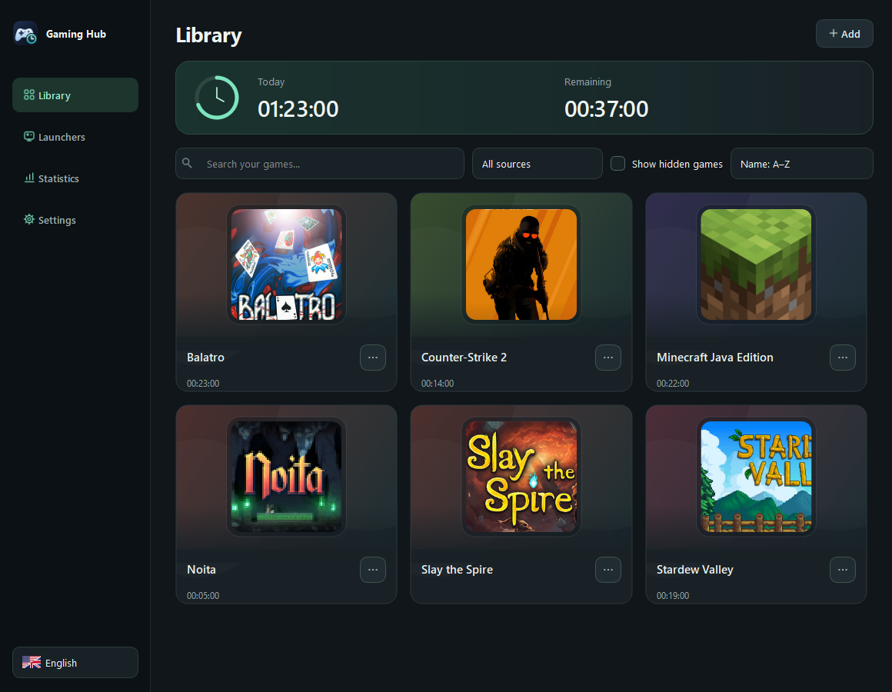
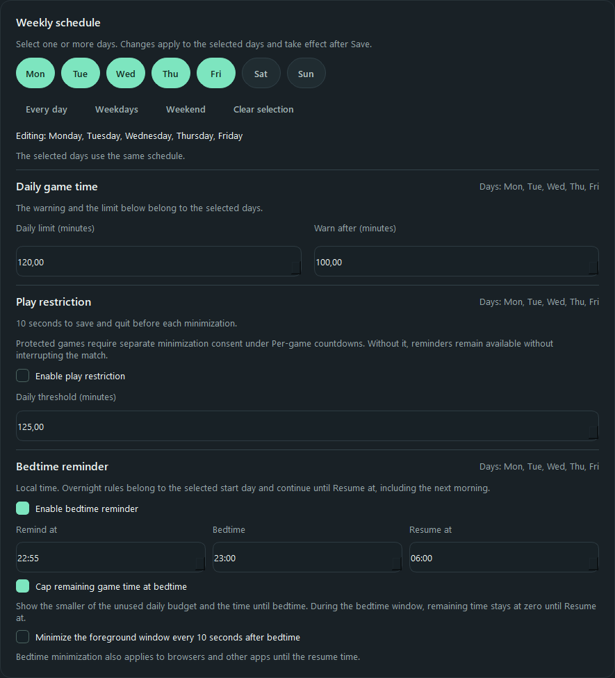
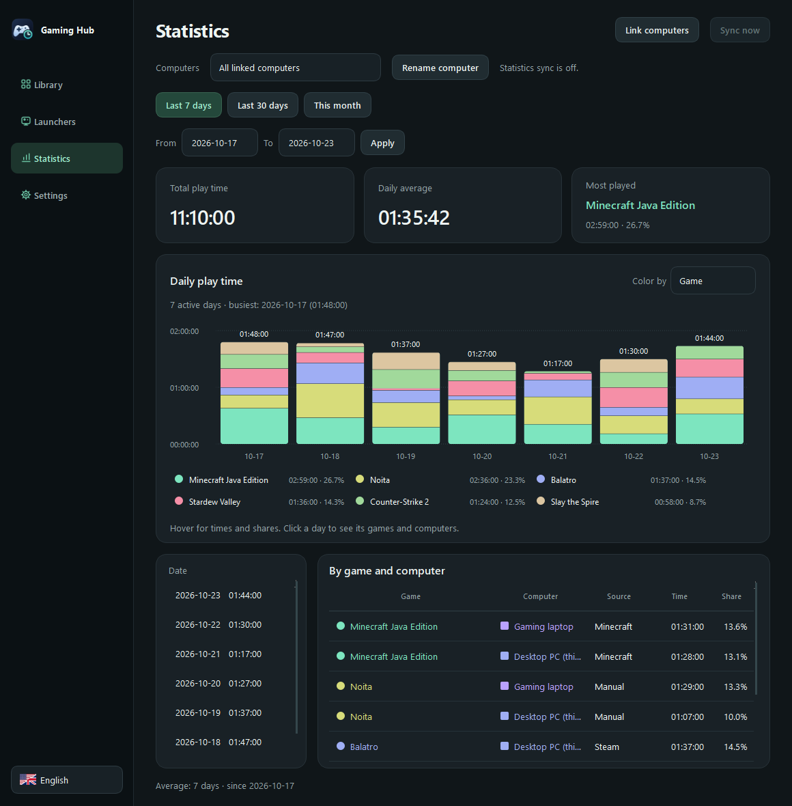

# Game Time Monitor — 2.26.2

**[Download for Windows x64 — 2.26.2](https://github.com/Blintboi/windows-game-time-monitor/raw/refs/heads/main/downloads/GameTimeMonitor-Setup.exe)** · [SHA-256 checksum](downloads/GameTimeMonitor-Setup.exe.sha256) · [Magyar](README.hu.md)

Game Time Monitor brings your installed games, daily play time and personal reminders into one Windows application. Plan your gaming time, follow your remaining allowance and review your habits across your own computers.

Free and open source, with an English and Hungarian interface. Local tracking works offline without an account; computer linking is optional.

## Features

- **Game library:** discover and launch installed games, search your collection and choose which games to track.
- **Daily budgets and weekly schedules:** set time limits, warnings and bedtime reminders for individual days or groups of days.
- **Customizable countdown:** see your remaining time while playing, with adjustable position, size, opacity and colors, including per-game styles.
- **Personal reminders:** write your own messages with remaining-time information, choose a sound or use a local WAV file.
- **Play-time statistics:** explore color-coded charts by game or computer, daily details and summaries for a selected period.
- **Optional computer linking:** combine statistics from your own PCs through encrypted synchronization and give each computer a recognizable name.

*Version 2.26.2 with sample history. Game artwork belongs to its respective owners.*

## Requirements and game support

**Windows 11 x64.** The installer includes the required runtime; Python does not need to be installed separately. Normal installation and use do not require administrator rights.

Supported game sources include **Steam, Epic Games Launcher, Ubisoft Connect, Riot Client, EA app / Origin, Battle.net, GOG Galaxy and offline GOG games, Xbox / Microsoft Store, Rockstar Games Launcher, Amazon Games and Minecraft: Java Edition**.

For standalone or unrecognized games, use the configured **Games folder** or assign a game executable manually. Existing launcher libraries can stay in their original locations. Recognition and launch support depend on the installation; some protected or Store packages may be unavailable.

## Getting started

1. Download and run **GameTimeMonitor-Setup.exe** using the link above.
2. Open **Gaming Hub** from the desktop shortcut or tray icon and review your library.
3. Set your schedule and reminders under **Settings**, then select **Save**.

The monitor starts in the tray when you sign in to Windows. Closing the Hub with **X** keeps tracking and reminders active; **Exit monitor** in the tray menu stops the application.

Updates preserve your history, settings and tracking exclusions. Automatic update notifications are enabled by default and can be disabled in Settings. **Download update** opens the installer in your browser; you choose when to download and install it.

The application is currently **unsigned**, so Windows may show an unknown-publisher warning or restrict execution. See the [Windows trust and signing guide (Hungarian)](docs/WINDOWS-TRUST.hu.md).

## Plan your play time

A shared daily budget covers all tracked games. Time counts while a recognized game is in the foreground, including its menus or pauses; background games, launchers and locked sessions do not consume the budget. The daily allowance resets at local midnight.

Use the seven day buttons in **Settings → Weekly schedule** to configure each day separately or apply a plan to a group. Set a daily budget, early warning and bedtime, with optional automatic minimization when a limit is reached.

The optional **Cap remaining game time at bedtime** setting limits the countdown to whichever comes first: the end of your daily allowance or bedtime. With two hours left at 23:00 and bedtime at midnight, the countdown shows one hour.

This is a personal time-management tool, not tamper-resistant parental control. Automatic minimization does not close games or shut down the PC and can have inactivity or leaving consequences in online games.

## Make the countdown and reminders your own

Choose a display, precise position, text size, opacity and separate normal and warning colors. Drag the placement preview or enter pixel coordinates. **Per-game countdowns** let you use a different position and style for each game, or hide its countdown.

Check the result with a ten-second preview over a compatible running game. A dim game image can help with placement; it is held only in memory. Compatible fullscreen games can use [RTSS 7.3.7 or later, installed separately](https://www.guru3d.com/download/rtss-rivatuner-statistics-server-download/).

Under **Settings → Custom messages**, personalize warning, daily-limit and bedtime messages, add time placeholders and choose a notification sound. Default messages can be restored at any time.

### Protected games

For detected protected games, overlays and game-image previews require explicit per-game risk consent. Automatic minimization requires separate consent, and some actions remain blocked. Reminders use nonactivating windows or sound where appropriate. These precautions do not guarantee compatibility or protection from bans. Review the [anti-cheat compatibility guide (Hungarian)](docs/ANTICHEAT.hu.md) before enabling these features.

## Statistics across your computers

Use **Statistics** to compare time by game or computer, select a date range and inspect individual days. Computer names can be edited to keep charts easy to read.

To link PCs, open **Statistics → Link computers** on the first computer, sign in with GitHub and enable synchronization. Enter its connection code on your other computers; joining an existing code does not require another GitHub sign-in.

Synchronization is optional and encrypted on your computer. **Keep the connection code private: anyone with it can access and change the group's shared history.** Budgets, settings and game exclusions remain local.

Updates between computers are not immediate: requests are at least ten minutes apart, with a shared limit of 20 successful requests per UTC day and 600 per month. Local tracking remains available offline and during service outages.

## Your data

Your profile is stored in the Windows Documents folder under `GameTimeMonitor\data`. There is no advertising or general analytics telemetry. Local history is not encrypted; optional cloud statistics are encrypted before upload.

Automatic update checks contact GitHub at most once a day. GitHub receives normal connection metadata, including your IP address; the check sends no play history, game details or computer name. Checks can be disabled.

To back up your profile, exit the monitor and copy the complete data folder. Uninstalling preserves that folder. See [Privacy](PRIVACY.md) for stored data, cloud retention and deletion, and [Security](SECURITY.md) for account and connection-code protection.

## Help and development

Report bugs or request features through [GitHub Issues](https://github.com/Blintboi/windows-game-time-monitor/issues). Keep connection codes, tokens and profile databases out of public reports; report security issues through the private route in [Security](SECURITY.md).

The project is released under the [MIT license](LICENSE), with separate [third-party notices](THIRD-PARTY-NOTICES.md). Development can be supported through [GitHub Sponsors](https://github.com/sponsors/Blintboi).

For building or contributing, see [Development](docs/DEVELOPMENT.md), [Architecture](ARCHITECTURE.md) and [Testing](TESTING.md).
