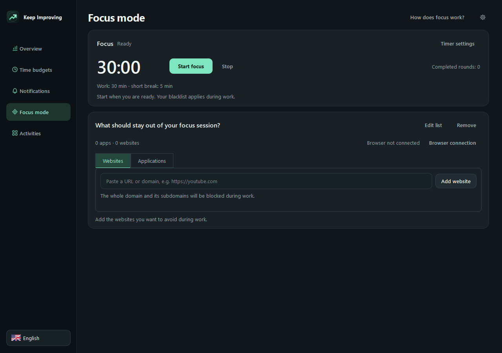

# Keep Improving — 2.31.2

**[Download for Windows x64 — 2.31.2](https://github.com/Blintboi/windows-game-time-monitor/raw/refs/heads/main/downloads/GameTimeMonitor-Setup.exe)** · [SHA-256 checksum](downloads/GameTimeMonitor-Setup.exe.sha256) · [Magyar](README.hu.md)

Keep Improving is a Windows app for understanding how you spend your computer time and deciding when to focus or play. It tracks recognized games while they are in the foreground, shows how much of your daily game budget remains, and can remind you or minimize a game when you reach a limit. Separately, it records active application time and, with its browser extension, time spent on websites. A Pomodoro timer can temporarily block the websites and minimize the applications you choose during a work interval.

The app is free and open source, with English and Hungarian interfaces. Tracking and the focus timer work locally without an account or internet connection; website tracking and blocking require the included extension. Linking statistics and supported settings between your own PCs is optional.

*The library shown is from 2.27.0 with sample history; navigation has since changed. Game artwork belongs to its respective owners.*

## Install and start

1. On **Windows 11 x64**, download and run the installer above. It includes the runtime: you do not need to install Python. Normal installation does not require administrator rights.
2. Open **Keep Improving** from the desktop or Start menu. Select English or Magyar at the bottom of the sidebar.
3. Open **Library** to review discovered games. If one is missing, use **Add** to select its executable, or configure the **Games folder** in Settings. Other launcher libraries can stay where they are.
4. Open **Settings → Weekly schedule**, select the days you want to change, set the daily budget and warning, then select **Save**. The initial budget is 120 minutes with a warning after 100 minutes; change these to suit you.
5. For website history and focus blocking, [connect the browser extension](#connect-the-browser-extension). For a focus session, open **Focus mode**.

In **Settings**, use the section buttons to jump to game time, reminders, the countdown, game folders or updates and sync. The bottom **Save** button applies changes on the page; separate dialogs have their own save buttons.

The monitor starts with Windows. Closing the window with **X** leaves it running in the system tray; choose **Exit monitor** from the tray menu to stop tracking and reminders. The installer is currently unsigned, so Windows may show an unknown-publisher warning. See the [Windows trust guide](docs/WINDOWS-TRUST.hu.md).

## What is measured?

- **Games:** the recognized, tracked game in the foreground consumes the shared daily game budget. Its menus and pauses count too; a game left in the background, a launcher, or a locked session does not. Game time continues to count even if you are not moving the mouse or keyboard.
- **Applications:** the foreground application is recorded locally, including time spent reading without keyboard or mouse input. Recording pauses when the session is locked or the computer sleeps. In **Statistics**, you can turn **Measure application and website time** off. This activity history is independent of the game budget.
- **Websites:** with a paired extension, the active public website domain is recorded while the browser is in the foreground, including when you are reading without input. Private tab domains, page titles, full URLs and page contents are not recorded; the browser can still be measured as an application during private browsing. Website time is a breakdown of browser time, not extra time added on top of it.

For example, if you play a tracked game for 30 minutes in the foreground and then switch to your browser, 30 minutes count against the game budget. After pairing the extension, time on `example.com` appears under websites when that tab is active. Application and website history is stored locally and is also shared with your linked computers when optional synchronization is enabled.

## Focus sessions and activity

Open **Focus mode**. The default cycle is 25 minutes of work, a 5-minute short break, and a 15-minute long break after four work intervals. Use **Timer settings** to change these durations and the number of rounds.

Add a website by pasting its domain or URL and selecting **Add website**; the domain and its subdomains are included. Under **Applications**, select previously detected applications or choose an `.exe` file. Select **Start focus** to start the work interval: listed websites are blocked in connected browsers, while listed foreground applications are minimized. Website blocking requires the extension; protected games retain their separate minimization permission. Pausing or stopping the timer releases restrictions. A break starts automatically after work; after the break, start the next work interval yourself. Restarting the app does not automatically resume a session.

**Statistics** shows application and website history for the selected period.

To exclude an application from activity tracking, select it in the applications list in **Statistics**, then choose **Exclude selected application**. It stops being measured and is hidden from application statistics. Existing records are kept and become visible again if you restore it through **Excluded applications**. Excluding a browser also stops new website measurements in that browser; previously recorded website history remains. Game tracking and the game budget are unaffected.

*The 2.31.1 interface with an example list; the current layout differs.*

## Connect the browser extension

The extension is included with the Windows app; you load its folder in each browser you want to use. These steps cover Brave, Chrome and Edge:

1. Keep the monitor running. In the app, open **Focus mode → Browser connection**. Leave the dialog open; it shows the extension folder and a **Copy pairing code** button.
2. In your browser, open its extension page: `brave://extensions`, `chrome://extensions`, or `edge://extensions`. Turn on **Developer mode**.
3. Choose **Load unpacked** and select the `browser_extension` folder shown in the app's dialog. **Open extension folder** can help you find it. Select the folder itself, not a file inside it.
4. Open **Keep Improving Focus** from the browser's extensions menu or its **Details → Extension options** page. Paste the code copied from the app, choose the browser you are using, and select **Save & connect**. Wait for **Connected**; the app also shows the connection status.
5. Repeat the loading and pairing steps in every browser and Windows profile where you want to measure sites or block them. Keep the pairing code private.

To check it, visit a public website in the foreground, use it for a short time, then choose **Websites** in **Statistics**. If it does not appear, check that the monitor and extension are running, the correct browser is selected, and the pairing code was copied in full. The extension sends the domain to the app over a local connection, not to an internet service. If the monitor is unavailable, browser restrictions are released. Removing or disabling the extension stops website tracking and website blocking in that browser; application tracking still works.

## Game library, limits and reminders

The library can discover games from Steam, Epic Games Launcher, Ubisoft Connect, Riot Client, EA app / Origin, Battle.net, GOG Galaxy and offline GOG games, Xbox / Microsoft Store, Rockstar Games Launcher, Amazon Games and Minecraft: Java Edition. Discovery and launching depend on the individual installation; some protected or Store packages may not be available. You can search, launch, hide or exclude games, or assign an executable manually. Hiding a game is different from excluding it from tracking.

The daily allowance is shared across tracked games. In **Settings → Weekly schedule**, select individual days or a group, set the budget, warning and reset time, and save. Midnight is the default reset; until the configured reset time the previous day's allowance applies. Statistics use calendar days. You can set a per-game cap from a game's menu or Settings: the on-screen countdown shows whichever allowance is smaller. At the per-game limit, the game is minimized and cannot be launched from the Hub, subject to protected-game permissions. A bedtime reminder can optionally cap remaining game time at bedtime.

Reminders can use custom text and sounds. You can enable a countdown over games and adjust its position, size, opacity and colors, including per-game settings. Exclusive fullscreen games may need [RTSS 7.3.7 or later](https://www.guru3d.com/download/rtss-rivatuner-statistics-server-download/), installed separately.

Automatic minimization is optional. Game-limit minimization gives a 10-second grace period; bedtime minimization can also affect other foreground applications. It does not close the game or shut down Windows and may have consequences in online games. Protected games require explicit per-game consent for overlays or previews and separate consent for minimization; compatibility and freedom from bans cannot be guaranteed. Read the [anti-cheat guide](docs/ANTICHEAT.hu.md). This is a personal time-management tool, not tamper-resistant parental control.

*The 2.31.1 interface with example settings; the current layout differs.*

## Statistics and optional computer linking

In **Statistics**, the default view shows Everything; you can choose Games, Applications or Websites, a date range and optionally a computer. Each day has one bar, split into separated computer sections with colored activity segments. The side colors match the computer legend below the chart, including when only one linked computer has data. Point at a section for its details or select a day. Applications excludes recognized games, and Everything avoids counting website time twice. Data on a newly installed computer begins accumulating as you use it.

*An earlier statistics interface with sample data; the current filters and layout differ.*

To combine **game, application and website statistics and supported settings** from your own PCs, open **Statistics → Computers & sync → Link computers**. On the first PC, sign in with GitHub and enable synchronization; enter its connection code on the other PCs. Joining an existing code does not require another GitHub sign-in. The code grants access to and the ability to change shared data, so keep it private. Data is encrypted on the computer before upload. Game budget consumption remains local. Daily application paths and website domains are included in the encrypted sync; full URLs and page contents are not.

Supported settings, including schedules, focus lists and per-game preferences, are exchanged with the existing sync; changes to different settings merge, and conflicting changes to the same setting resolve deterministically. Account credentials, computer names, local folders, monitor selection, custom sound file paths and protected-game consent remain local. Application block and exclusion rules contain executable paths, which may differ across PCs. All computers need the newer version to share application and website history and settings. No separate request is made when settings are unchanged.

Sync is not immediate: requests are at least ten minutes apart, with a shared limit of 20 successful requests per UTC day and 600 per month. Local tracking continues offline or when the service is unavailable.

## Data, updates and help

Your profile is stored under `Documents\GameTimeMonitor\data`. To back it up, exit the monitor and copy the whole folder. Uninstalling preserves it. Local history is not encrypted. The app has no advertising or general analytics telemetry; see [Privacy](PRIVACY.md) and [Security](SECURITY.md) for storage, synchronization, retention and deletion.

Automatic update checks contact GitHub at most once a day and can be disabled in Settings. GitHub receives normal connection metadata such as your IP address; the check does not send your history, game details or computer name. An update is downloaded through your browser and installed when you choose; upgrades preserve your history and settings.

Report problems or request features in [GitHub Issues](https://github.com/Blintboi/keep-improving/issues). Do not post connection codes, tokens or profile databases there; use the private reporting route in [Security](SECURITY.md) for security issues. The project uses the [MIT license](LICENSE); see [third-party notices](THIRD-PARTY-NOTICES.md), [development](docs/DEVELOPMENT.md), [architecture](ARCHITECTURE.md) and [testing](TESTING.md).
