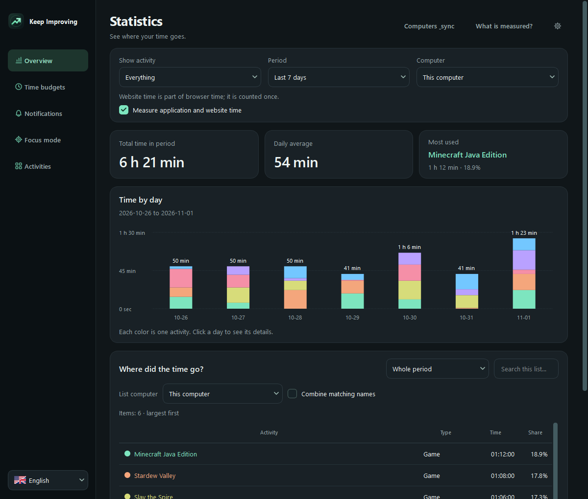
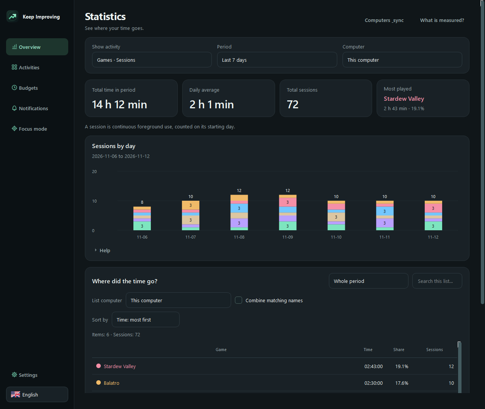
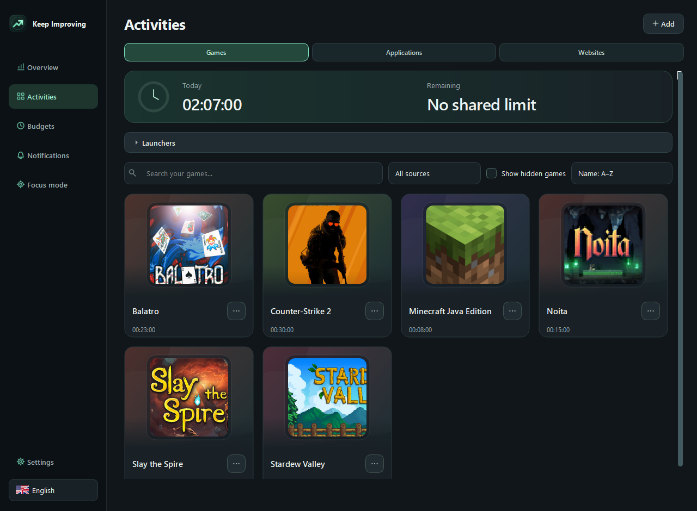
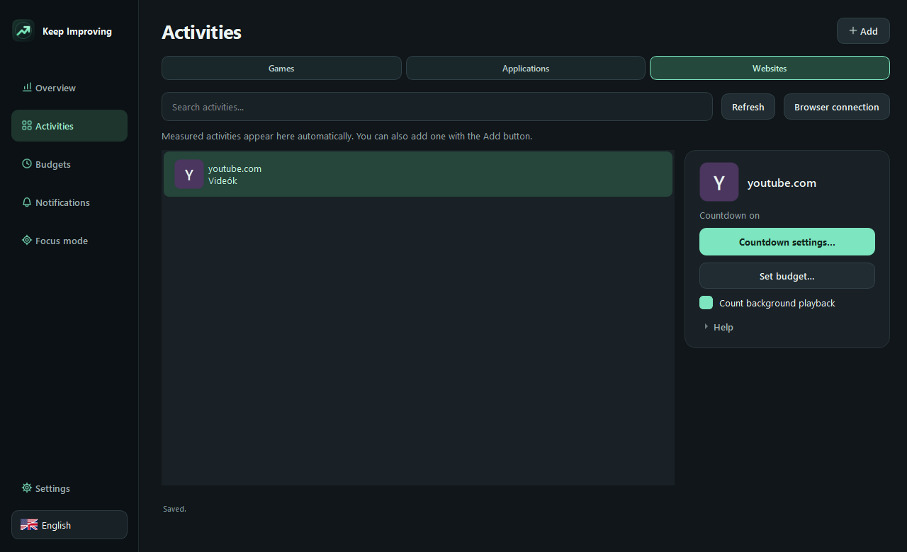
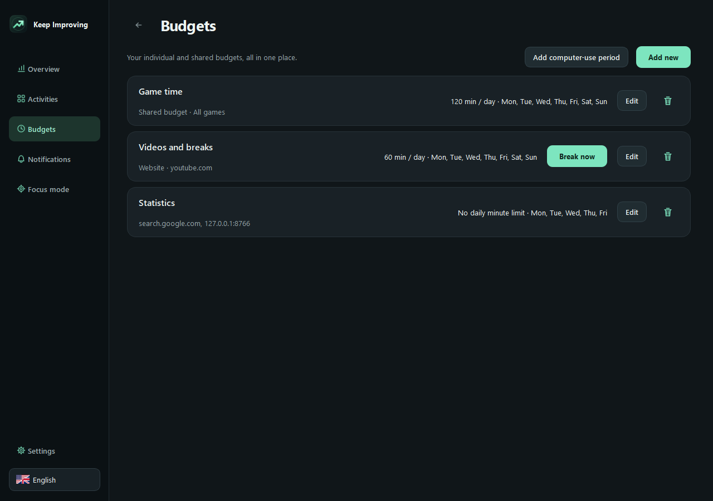
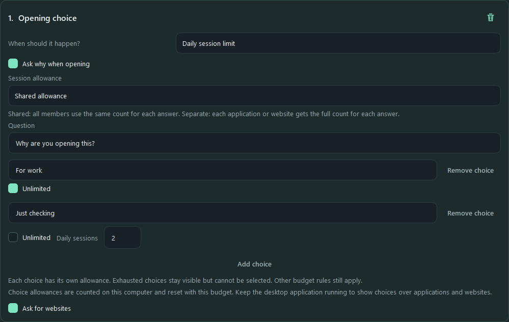
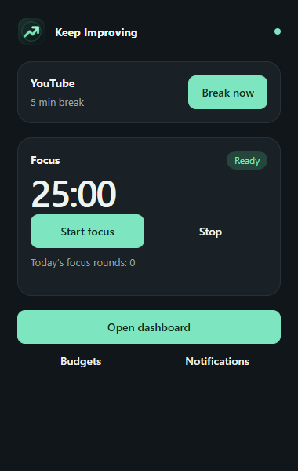
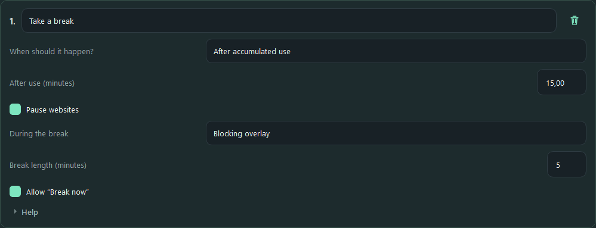
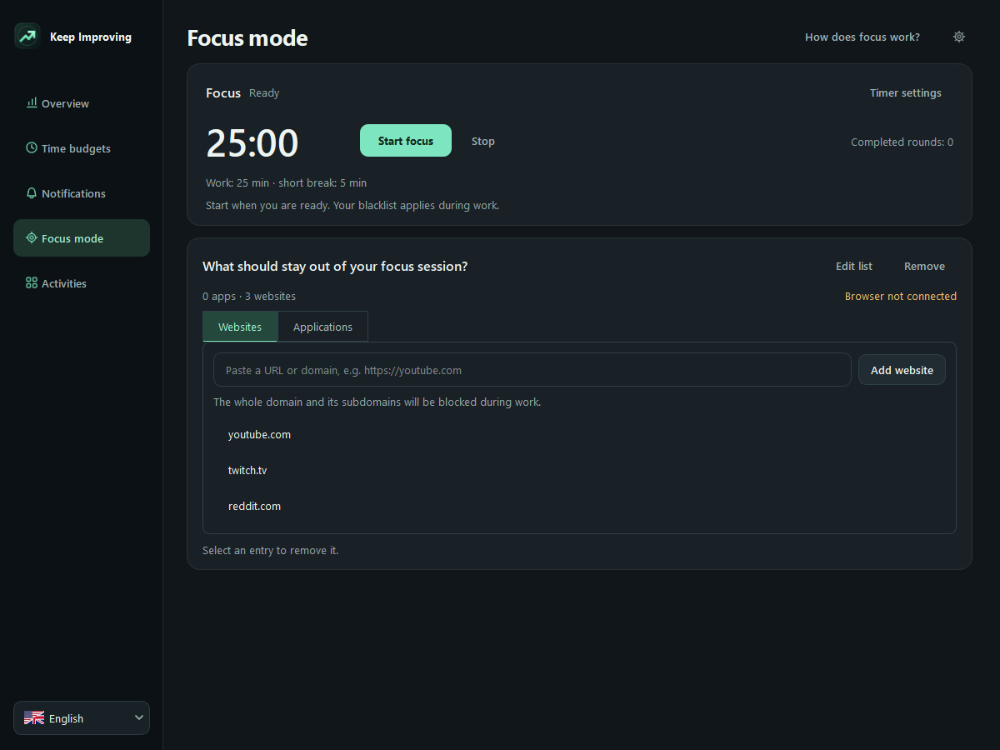

# Keep Improving — 2.49.1

**[Download for Windows x64 — 2.49.1](https://github.com/Blintboi/windows-game-time-monitor/raw/refs/heads/main/downloads/GameTimeMonitor-Setup.exe)** · [SHA-256](downloads/GameTimeMonitor-Setup.exe.sha256) · [Magyar](README.hu.md)

**[Download for Android — 0.6.0 (.apk)](https://github.com/Blintboi/keep-improving/raw/refs/heads/main/downloads/KeepImproving-Android.apk)** · [SHA-256](downloads/KeepImproving-Android.apk.sha256) · [Phone setup](android/README.md)

See where your time goes, choose how often you return, and make room for breaks. Keep Improving measures foreground activity and offers time budgets, daily session limits, reminders and focus timers. It is free and open source, with English and Hungarian interfaces.

*Screenshots show the current Windows application with an isolated demonstration profile. All usage, budgets and choices are examples; no personal history or connection codes are shown.*

## Start here

1. Install on **Windows 11 x64**. Python and administrator rights are not required for a normal installation. Upgrades preserve your profile.
2. Review your games, applications and websites under **Activities**. Add missing games by choosing their executable.
3. Open **Budgets → Add new**, select the members, choose active days and add the limits or reminders you want.
4. For websites, [pair the browser extension](#browser-extension). On Android 8.0 or newer, install the APK and follow the [phone guide](android/README.md).

Closing the Windows window leaves the monitor running in the tray. **Exit monitor** stops it. New profiles have no compulsory budget. The Windows installer is unsigned; see the [Windows trust guide](docs/WINDOWS-TRUST.hu.md).

## Understand your usage

**Overview** can show either time or **session counts** in its chart. Choose the activity type and measure in **Show activity**, then filter by period and device. The activity list can be searched, sorted by time or sessions, and combined by matching names.

A session is a continuous measured foreground visit, counted on its starting day. The app shows the number it could measure; it does not invent counts for older history. Foreground use includes reading and game menus. Under **Activities → Applications / Websites**, select an activity and enable **Count background playback** to also measure its audible playback on this computer while the desktop app runs. Paused or muted playback does not count in the background. The option is off by default and does not add sessions. Matching budgets include the time; a shared budget counts each second once. The overview can show parallel activity time, so its total may exceed elapsed time. Website time replaces the corresponding browser time.

Session chart and activity library

*Game artwork belongs to the respective owners.*

## Set boundaries that fit the activity

A budget can contain one activity, several games/apps/websites, or a whole category. Choose its **active days**, optional daily minute allowance and actions. All daily budgets follow **Settings → General → Day starts at**. A zero-minute budget blocks immediately; the minute allowance can also be disabled when another type of limit is enough.

| Trigger | Example |
| --- | --- |
| Accumulated usage time | Take a five-minute break after every fifteen minutes of use. |
| Daily time | Restrict an activity from 22:00. |
| Daily session limit | Allow five visits; trigger the action on the sixth opening. |

Choose a **warning**, **break** or **restriction**. For games/apps, actions can minimize, cover and mute, or close as supported. Websites can be blocked, redirected or closed. Mixed budgets have separate settings for application and website behavior. Closing requires explicit acknowledgement and can provide a one-time save allowance. Overlapping limits remain in force.

### Ask why before opening

Under **Daily session limit**, enable **Ask why when opening** and write your question and 2–8 answers. Each answer can be unlimited or have a daily allowance. For example, “For work” can be unlimited while “Just checking” allows two visits. A used-up answer stays visible but disabled.

Choose **Shared allowance** to pool answers across all budget members, or **Separate allowance per member** to give each app/site its own allowance. These answer counts remain local to this computer and survive restarts. The question appears over a website's existing page; it needs the paired extension and running desktop app.

### Take a break early

Enable **Allow “Break now”** on a repeating usage-time break. The button appears in the matching **Budgets** row in the app and extension; it is also available at the top of the extension popup, even after leaving the website or hiding its countdown. One click starts the full break and shows the time remaining. The floating countdown stays a countdown.

A complete early break starts a fresh full usage interval. For a 15-minute / 5-minute rule, starting the break after 12 minutes gives a full five-minute break, then a new fifteen-minute interval. Unused minutes do not carry over, and the daily allowance is preserved. Active breaks survive restarts.

### Include local websites

Add an address such as `http://127.0.0.1:8766/` in the member picker. `localhost:8766` and `[::1]:8766` use the same allowance; another port is a separate website. Local endpoints are measured only after you explicitly add them to a budget or focus block list. URL paths, parameters and page contents are not recorded in activity history.

Unfinished budget edits stay in a local draft until **Save changes** or **Discard draft**. Deleting a budget preserves activity history. You can also add independent **computer-use periods**, with chosen days, start/end times, warnings and window minimization.

## Focus, reminders and countdowns

**Focus mode** provides a configurable Pomodoro timer and selected application, website and budget-group restrictions during work intervals. Pause, stop and breaks release focus restrictions. Zero rounds means a single focus interval; zero-minute breaks are skipped.

**Notifications** supports reminders by clock time, app startup and daily completed focus goals, with optional sound, custom icons and buttons to start a timer or open an application. Reminders are configured separately from restrictions.

The countdown shows time until the next event and the remaining daily allowance when different. Change its visibility, position, size and colors in **Countdown settings…**. Supported games can use separately installed RTSS; see [game compatibility and anti-cheat guidance](docs/ANTICHEAT.hu.md).

## Browser extension

For **Brave, Chrome and Edge**:

1. In the running app, open **Activities → Websites → Connect browser**.
2. Open the browser's extensions page and enable **Developer mode**.
3. Choose **Load unpacked** and select the `browser_extension` folder shown by the app.
4. Open the extension, choose **Connect browser**, enter the pairing code and select your browser. Keep the code private.
5. Repeat for every browser/profile you use. **Open dashboard** gives you the full interface in a browser tab.

The app and browser dashboard share the same profile. The paired extension reloads automatically after an app upgrade, preserving pairing and covered-page recovery. If the desktop app stops, **Browser mode** can continue cached web limits, browser measurement and focus timing. Reconnection merges recovered activity once. Editing settings, opening-purpose questions and control of other Windows apps require the desktop app. Disabling the extension stops its measurement and enforcement.

## Use your phone and other computers

Android has its own application measurement, session limits, breaks, focus timer and reminders. It can show synchronized PC website history, but measures its own browser as an application. Enable usage access for measurement and the optional covering service for responsive limits. The Windows opening-purpose chooser and early-break button are not yet available on Android. [Android features and permissions](android/README.md).

Link devices using **Overview → Computers & sync** on Windows and **Settings → Devices & sync** on Android. Sign in with GitHub to create a connection code, then use that code on your other devices. History and supported settings are encrypted before upload; keep the code private.

Budgets can select a device, a device group or all linked devices. Selected devices share the allowance; simultaneous usage adds together. An Android app and a Windows executable must be selected separately. Remote usage and edits appear after synchronization. Offline devices use the last received totals, so a shared limit can temporarily be exceeded. The interface reports sync status; background delivery also depends on Android scheduling and service quotas.

## Data, updates and help

The Windows profile is in `Documents\GameTimeMonitor\data`. Exit the monitor and copy the whole folder to back it up; uninstalling preserves it. Local history is not encrypted. There are no ads or general analytics telemetry. Private-tab domains, page titles and page contents are not recorded. See [Privacy](PRIVACY.md) and [Security](SECURITY.md).

Update checks contact GitHub at most once per day and can be disabled. You choose when to install. The direct downloads at the top of this page are the primary distribution path.

This is a voluntary personal time-management tool. Report problems in [GitHub Issues](https://github.com/Blintboi/keep-improving/issues), without codes, tokens or profile databases. More: [MIT license](LICENSE), [third-party notices](THIRD-PARTY-NOTICES.md), [development](docs/DEVELOPMENT.md), [architecture](ARCHITECTURE.md), [testing](TESTING.md).
